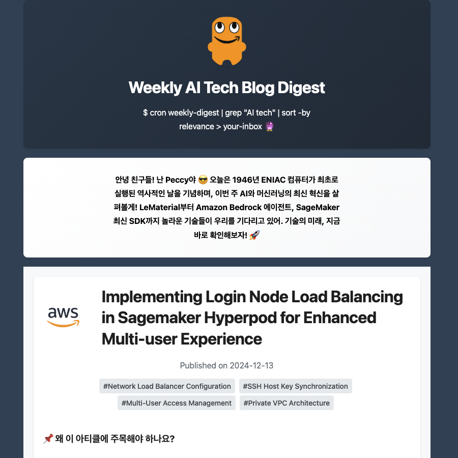

<div align="center">

# 🤖 주간 AI 기술 블로그 다이제스트

**선도적인 기술 블로그에서 그 주의 가장 좋은 AI/ML 엔지니어링 글을 모아 큐레이션·필터링·요약한 뒤 이메일로 보내 주는 자동화 뉴스레터.**

Amazon Bedrock 기반(필터 GPT-6.1 Sol, 요약 Claude) · AWS 위에서 CDK로 정의·오케스트레이션.

[](https://github.com/bits-bytes-nn/tech-digest/actions/workflows/ci.yml)


🇺🇸 [English README](./README.md)



</div>

---

## ✨ 주요 기능

- **AI 기반 큐레이션**. Amazon Bedrock에서 GPT-6.1 Sol이 글마다 관련성을 점수로 매기고,
  Claude가 여러 섹션으로 구조화된 요약을 씁니다.
- **다중 소스 집계**. RSS와 견고한 HTML 스크레이핑으로 약 20개 기술 블로그(AWS,
  Google, Meta, Microsoft, NVIDIA 등)에서 글을 모읍니다. 모든 요청에는
  SSRF 가드와 소스별 헬스 추적이 따라붙습니다.
- **콘텐츠 품질 게이트**. 본문이 너무 빈약한 글은 LLM에 닿기 *전에* 걸러내, 빈
  껍데기 글이 다이제스트에 실리지 않게 합니다.
- **훑어볼 수 있는 카드**. 카드마다 핵심을 한 문장으로 먼저 제시하고 읽는 시간을
  표시하며, 관련도가 가장 높은 글이 맨 앞에 옵니다.
- **클립 예산 인식**. 메일 클라이언트는 약 100KB를 넘는 본문을 잘라냅니다. 요약
  분량 예산과 템플릿 마크업 무게를 함께 조율해 그 아래로 유지하고, 잘릴 크기라면
  빌드가 경고합니다.
- **크롤 헬스 모니터링**. 모든 소스의 페치 상태를 추적하다가 소스가 실패하거나
  **걸러낼 것을 아무것도 내놓지 못하면** 알림을 띄웁니다. 그러지 않으면 이전한 피드와
  깨진 스크레이퍼가 조용한 블로그와 구별되지 않고, 정상적인 주에도 소스 대부분이
  비어 있습니다. 조용한 블로그는 절대 알림을 띄우지 않으며, AWS 송신 IP에서 상시
  실패하는 소스는 허용 목록으로 빼서 알람이 계속 조치 가능한 상태로 남습니다.
- **서버리스 인프라**. 설정으로 고르는 AWS Lambda *또는* Batch 위에서 돌아가며,
  EventBridge로 스케줄링하고 AWS CDK로 코드화합니다.
- **완성도 높은 이메일**. 다크모드, 소스별 로고, 점수 배지, 캡션 달린 이미지, 그리고
  완전히 현지화된 UI 문구(KO/EN)를 갖춘 반응형 HTML 템플릿을 Amazon SES로 전달합니다.
- **멱등한 발송**. 호마다 어떤 수신자에게 전달됐는지를 S3 원장에 기록하므로, 재시도된
  실행(스팟 회수, OOM 등)이 같은 호를 두 번 보내지 않고 아직 못 받은 독자에게만
  보냅니다.
- **추측이 아니라 측정**. 프롬프트는 감이 아니라 두 가지 채점 도구의 결과를 보고 고칩니다. 하나는
  *필터*("올바른 글을 골랐나"), 하나는 *출력*("글이 잘 써졌나")을 채점합니다. 출력 검사는
  전부 결정적이며 프롬프트 규칙과 1:1로 대응하므로, 낮은 점수가 **어느 지시문을 고쳐야
  하는지**를 알려줍니다.
- **재현 가능한 빌드**. 베이스 이미지를 digest로 고정하는 것에 더해 전이 의존성을 포함한 모든 Python 의존성을
  `app/requirements.lock`으로 고정하고, CI가 이를 constraints로 적용해 **테스트가 실제
  배포되는 버전을 검증**합니다.
- **단계별 비용 추적**. 온디맨드 Bedrock에는 태그를 붙일 리소스가 없으므로, 태그가 달린
  애플리케이션 추론 프로파일로 호출하고 파이프라인 단계별 토큰 사용량을 로깅합니다.

---

## 📐 문서

**AWS 아키텍처** (인프라와 데이터 흐름):


**처리 파이프라인** (수집에서 전달까지):


---

## 🏗️ 아키텍처

### 핵심 구성 요소

| 모듈 | 책임 |
| --- | --- |
| `feed_parser.py` | RSS 파싱 + HTML 스크레이핑(BeautifulSoup4), 소스별 헬스 추적 |
| `summarizer.py` | 콘텐츠 게이트 → 관련성 필터 → 랭킹/캡 → 요약까지, 모두 Bedrock으로 |
| `model_factory.py` | Bedrock 모델 능력 레지스트리 + LangChain 채팅 모델 생성, 비용 귀속 프로파일 |
| `quality_metrics.py` | 결정적 출력 품질 루브릭 (순수 함수) |
| `eval_metrics.py` | 필터 점수 지표 (순수 함수) |
| `newsletter_renderer.py` | Jinja2 기반 HTML 생성(반응형, 다크모드, 현지화, 크기 검사) |
| `aws_helpers.py` | S3, SES, SNS, SSM, Batch 연동 |

### 파이프라인

```
collect → gate → filter → rank → summarize → greet → render → deliver
```

### 인프라

- **Lambda / Batch**. `lambda_or_batch` 설정으로 실행 환경을 고릅니다.
- **EventBridge**. 정해진 일정에 실행합니다(템플릿 기본값: 금요일 01:00 UTC, prod는 토요일).
- **S3**. 설정, 수신자 목록, 생성된 뉴스레터, 글 HTML을 보관합니다.
- **SSM Parameter Store**. LangChain API 키와 Batch 큐/정의 이름을 저장합니다.
- **SES**로 뉴스레터를 전달하고, **SNS**로 실행·헬스 알림을 보냅니다.
- **Bedrock(us-west-2)**. GPT-6.1 Sol(필터), Claude Sonnet 5.5(요약), Claude Haiku 5.5(인사말,
  제목 Title Case, 출력 복구). [`app/src/constants.py`](./app/src/constants.py)의 `LanguageModelId`
  카탈로그에 있는 모델은 OpenAI GPT-6 모델을 포함해 스테이지별로 골라 쓸 수 있습니다.
  모델별 요청 규칙(thinking 끄기 값, effort, GPT 호출 방식)은 design.md §8에 있습니다.

---

## 🛠️ 기술 스택

- **언어 / IaC:** Python 3.12+, AWS CDK, Docker
- **AI:** Amazon Bedrock, LangChain
- **스크레이핑:** Feedparser, BeautifulSoup4
- **렌더링 / 설정:** Jinja2, Pydantic, YAML

---

## 📋 설정

`app/configs/config-{stage}.yaml`(예: `config-dev.yaml`)을 만드세요. 최상위 네 개
섹션은 [`app/configs/config.py`](./app/configs/config.py)의 Pydantic 모델에 그대로
대응합니다.

```yaml
resources:
  project_name: tech-digest
  stage: dev
  lambda_or_batch: batch
  cron_expression: "cron(0 1 ? * 6 *)"   # 금요일 01:00 UTC(EventBridge는 1 = 일요일)

scraping:
  min_content_length: 600                # 이보다 빈약한 글은 제외(가시 텍스트 문자 수)
  expected_flaky_urls: []                # 실패를 리포트만 하고 알림은 띄우지 않을 URL 일부
  rss_urls:
    - "https://aws.amazon.com/blogs/amazon-ai/feed/"
    - "https://www.amazon.science/index.rss"

summarization:
  filtering_model_id: openai.gpt-6.1-sol
  summarization_model_id: anthropic.claude-sonnet-5-5
  greeting_model_id: anthropic.claude-haiku-5-5
  min_score: 0.7                         # 이 점수 이상인 글만 유지
  max_posts: 5                           # 남길 글 수 상한(요약 전에 적용)
  max_per_source: 2                      # 소스 다양성 캡(선택). 빈 자리는 랭크 순으로
                                         # 다시 채우므로 발행 편수는 줄지 않음

newsletter:
  sender: "your-verified-sender@example.com"
  header_title: "Weekly AI Tech Blog Digest"
```

> 모델 ID는 [`app/src/constants.py`](./app/src/constants.py)의 `LanguageModelId`
> 카탈로그에서 가져다 씁니다.

---

## 🚀 사용법

### 인프라 배포

```bash
# deploy_infra.py는 CDK 앱이라 합성만 합니다. 배포는 `cdk deploy`로 합니다.
# --profile은 resources.profile_name과 같은 계정이어야 합니다. 앱은 계정 조회와
# SSM 시크릿 쓰기에 설정의 프로필을 씁니다.
CONFIG_FILE_SUFFIX=dev cdk deploy NewsletterDevStack --profile <aws-profile>
CONFIG_FILE_SUFFIX=prod cdk deploy NewsletterProdStack --profile <aws-profile>
python scripts/put_inference_profiles.py --stage dev   # 계정/스테이지마다 한 번
```

### Bedrock 비용 귀속

온디맨드 Bedrock 호출에는 태그를 붙일 리소스가 없으므로, `scripts/put_inference_profiles.py`가
설정된 모델마다 `Project`/`Stage` 태그를 단 애플리케이션 추론 프로파일을 만들고 모델 해석 시
이를 우선합니다. 프로파일이 없으면 시스템 정의 ID를 씁니다. 모든 호출은 단계별로
`LLM usage stage=... model=... input=... output=...`를 로그로 남깁니다.

- `application-inference-profile`은 `inference-profile`과 다른 IAM 리소스 타입입니다. 정책이
  둘 다 허용하지 않으면 프로파일이 생기는 순간부터 모든 호출이 `AccessDenied`가 됩니다.
- Billing → 비용 할당 태그에서 `Project` 태그를 활성화해야 Cost Explorer에 나타납니다(최대
  24시간, 소급 적용 안 됨).

자세한 내용은 [design.md §8](./docs/design.md#8-bedrock-모델-팩토리-appsrcmodel_factorypy--배치-처리-appsrcutilspy)을 참고하세요.

### 로컬 실행

```bash
# 런타임 의존성 설치
pip install -r requirements.txt

# 환경 구성
cp .env.template .env        # 복사한 뒤 .env 편집

# 특정 주차의 다이제스트 생성·발송
python -m app.main --end-date 2026-06-03 --recipients you@example.com

# 또는 Batch 잡으로 제출
python -m app.run_batch --end-date 2026-06-03 --language ko --recipients you@example.com
```

`--recipients`는 지정한 주소로만 보내고 전달 원장을 읽지도 쓰지도 않습니다. 유효한 주소가
하나도 없으면 `run_batch.py`는 전체 수신자 목록으로 넘어가지 않고 오류로 종료합니다.

### 테스트 & 품질 게이트

```bash
# 개발 도구 설치(ruff, mypy, pytest)
pip install -e ".[dev]"

# 린트, 포맷 검사, 타입 검사, 테스트
ruff check .
ruff format --check .
mypy app                     # main.py / run_batch.py를 포함한 패키지 전체
pytest                       # 빠른 오프라인 단위/통합 스위트

# 생성된 실행 결과에 대한 출력 품질 루브릭. 채점은 결정적이고 오프라인이며 무료입니다.
# --regenerate만 예외로 실제 Bedrock을 호출합니다.
# 각 차원이 요약 프롬프트의 규칙 하나에 대응하므로, 낮은 점수는 어느 지시문을
# 고쳐야 하는지를 알려줍니다. 종합 점수는 등급형 차원만 평균하고, 계약 검사(구조,
# 리드, 캡션 등)는 위반으로 따로 표시합니다. 등급형 중 번역투와 상투구 두 차원은 빈도로
# 채점합니다 — 적게 쓰면 평범한 한국어이기 때문입니다. --compare로 수정 효과 검증.
python scripts/eval_summary_quality.py --date 2026-08-19
python scripts/eval_summary_quality.py --compare 2026-08-18 2026-08-19

# 프롬프트 수정을 같은 입력으로 A/B: 과거 실행에 저장된 기사를 현재 프롬프트로 다시
# 요약해 루브릭을 비교합니다. 비용이 발생합니다(기사당 호출 1회).
python scripts/eval_summary_quality.py --regenerate 2026-08-19

# 필터 루브릭 수정을 라벨 없이 실제 후보로 판단: 최근 몇 주의 후보를 고정하고 수정 전후로
# 채점한 뒤(비용 발생), 라인업이 바뀐 글을 확인합니다. 전체 절차는 스크립트 docstring에 있습니다.
python scripts/replay_filter.py collect --stage prod --weeks 6
python scripts/replay_filter.py score --stage prod --label before   # 그다음 수정
python scripts/replay_filter.py score --stage prod --label after
python scripts/replay_filter.py compare --stage prod before after
```

CI는 `main`으로 가는 푸시와 풀 리퀘스트에서 린트, 포맷, 타입, 테스트 검사를
실행합니다([`.github/workflows/ci.yml`](./.github/workflows/ci.yml)). 출력 품질 루브릭은 생성된
실행 결과가 있어야 하므로 직접 돌립니다.

---

## 📄 라이선스

MIT
