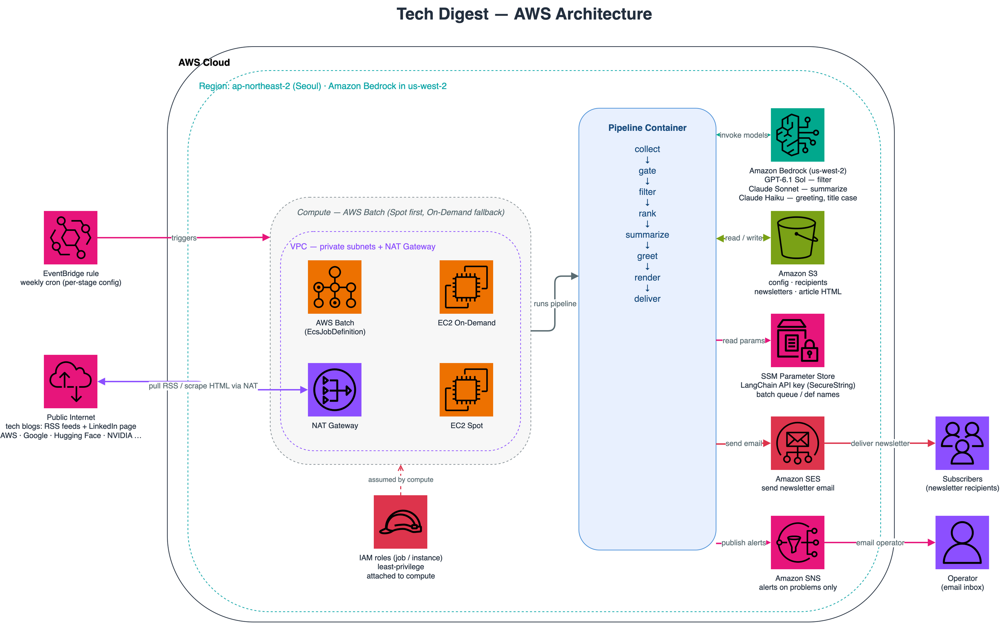
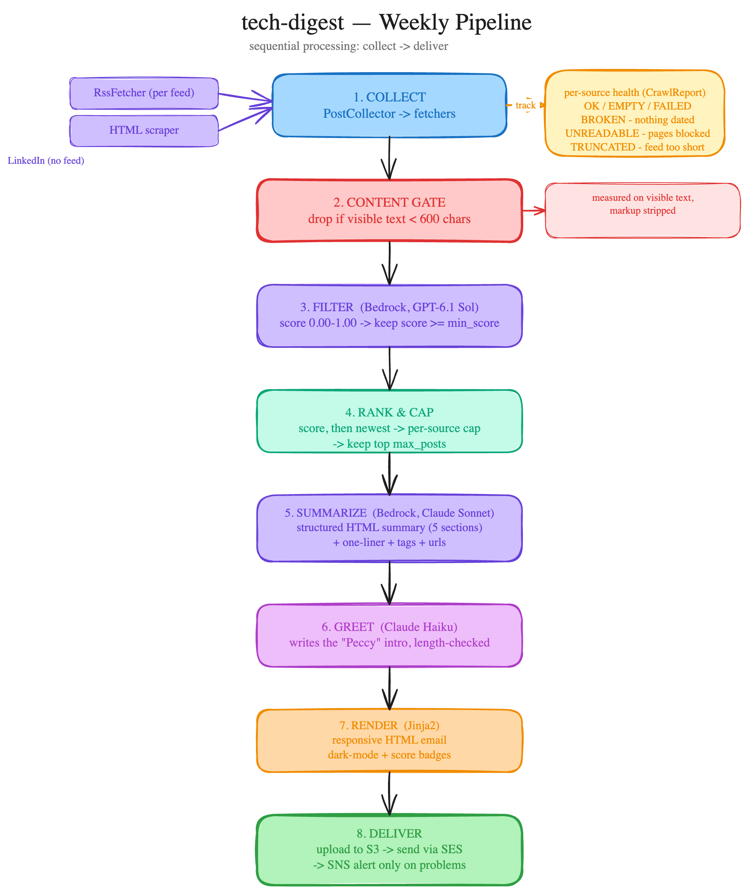

# Tech Digest 설계 문서

주간 AI 기술 블로그 다이제스트를 만들어 메일로 보내는 서비스의 설계 문서입니다.
코드가 지금 어떻게 동작하고 왜 그렇게 생겼는지를 설명하는 것이 목적이고, 코드가 바뀌면
이 문서도 같이 바꿉니다. 설치하고 돌려보는 방법은 루트의 `README.md`에 있습니다.

## 이 문서를 읽는 방법

앞에서부터 읽을 필요는 없습니다. 대부분은 아래처럼 필요한 데만 들어옵니다.

| 하려는 일 | 볼 곳 |
| --- | --- |
| 전체가 어떻게 돌아가는지 한 번에 보기 | [1. 시스템 개요](#1-시스템-개요), [2. 다이어그램](#2-아키텍처-다이어그램) |
| 크롤링할 블로그 추가·수정 | [6. 크롤링 & 파싱](#6-크롤링--파싱-appsrcfeed_parserpy) |
| 요약 품질이 마음에 안 들 때 | [9. 프롬프트](#9-프롬프트--프롬프트-캐싱-appsrcpromptspromptspy), [10. 필터링 & 요약](#10-필터링--요약-appsrcsummarizerpy) |
| 메일 모양·레이아웃 손보기 | [13. 렌더링](#13-뉴스레터-렌더링-appsrcnewsletter_rendererpy), [14. 템플릿](#14-이메일-템플릿-apptemplates) |
| 새 모델로 갈아타기 | [5. 상수](#5-상수--enum-appsrcconstantspy), [8. 모델 팩토리](#8-bedrock-모델-팩토리-appsrcmodel_factorypy--배치-처리-appsrcutilspy) |
| 비용이 얼마나 드는지, 어디에 쓰이는지 | [8. 모델 팩토리](#8-bedrock-모델-팩토리-appsrcmodel_factorypy--배치-처리-appsrcutilspy), [13. 렌더링](#13-뉴스레터-렌더링-appsrcnewsletter_rendererpy) |
| 메일이 안 왔을 때, 알림을 받았을 때 | [22. 운영 런북](#22-운영-런북), [SNS 알림](#sns-알림), [7. 크롤러 헬스](#7-크롤러-헬스-추적) |
| 왜 다르게 만들지 않았는지 | [23. 알려진 한계](#23-알려진-한계--향후-과제) |
| 어떤 결정이 어떤 측정과 사고에서 나왔는지 | [`CHANGELOG.md`](./CHANGELOG.md) |

이 프로젝트에서 고쳐 온 버그는 대부분 **조용히 잘못되는** 종류였습니다. 소스 하나가
막혀도 실행은 성공으로 끝나고, 요약이 실패해도 메일은 나가고, 점수가 흔들려도 아무 로그도
남지 않습니다. 그래서 규칙마다 그 규칙이 막는 실패를 한 문장으로 같이 적었습니다. 그 실패가
실제로 일어난 경위와 측정 기록은 `docs/CHANGELOG.md`에 주제별로 모아 두었습니다.

## 목차

1. [시스템 개요](#1-시스템-개요)
2. [아키텍처 다이어그램](#2-아키텍처-다이어그램)
3. [저장소 구조](#3-저장소-구조)
4. [설정 (`app/configs/`)](#4-설정-appconfigs)
5. [상수 & Enum (`app/src/constants.py`)](#5-상수--enum-appsrcconstantspy)
6. [크롤링 & 파싱 (`app/src/feed_parser.py`)](#6-크롤링--파싱-appsrcfeed_parserpy)
7. [크롤러 헬스 추적](#7-크롤러-헬스-추적)
8. [Bedrock 모델 팩토리 (`model_factory.py`) & 배치 처리 (`utils.py`)](#8-bedrock-모델-팩토리-appsrcmodel_factorypy--배치-처리-appsrcutilspy)
9. [프롬프트 & 프롬프트 캐싱 (`app/src/prompts/prompts.py`)](#9-프롬프트--프롬프트-캐싱-appsrcpromptspromptspy)
10. [필터링 & 요약 (`app/src/summarizer.py`)](#10-필터링--요약-appsrcsummarizerpy)
11. [콘텐츠 충분성 게이트](#11-콘텐츠-충분성-게이트)
12. [인사말 생성 (`app/src/greeter.py`)](#12-인사말-생성-appsrcgreeterpy)
13. [뉴스레터 렌더링 (`app/src/newsletter_renderer.py`)](#13-뉴스레터-렌더링-appsrcnewsletter_rendererpy)
14. [이메일 템플릿 (`app/templates/`)](#14-이메일-템플릿-apptemplates)
15. [AWS 헬퍼 (`app/src/aws_helpers.py`)](#15-aws-헬퍼-appsrcaws_helperspy)
16. [오케스트레이션 (`app/main.py`)](#16-오케스트레이션-appmainpy)
17. [배치 제출 (`app/run_batch.py`)](#17-배치-제출-apprun_batchpy)
18. [인프라 코드 (`scripts/deploy_infra.py`)](#18-인프라-코드-scriptsdeploy_infrapy)
19. [컨테이너 (`app/Dockerfile-*`)](#19-컨테이너-appdockerfile-)
20. [테스트 & CI/CD](#20-테스트--cicd)
21. [로컬 vs AWS 차이](#21-로컬-vs-aws-차이)
22. [운영 런북](#22-운영-런북)
23. [알려진 한계 & 향후 과제](#23-알려진-한계--향후-과제)

---

## 1. 시스템 개요

Tech Digest는 AI/ML 엔지니어링 블로그의 새 글을 매주 모아 골라 읽고, 요약해서
메일로 보내 주는 파이프라인입니다. 사람이 손대는 부분은 없습니다.

매주 정해진 시각에 Amazon EventBridge가 파이프라인을 깨웁니다. 그러면 컨테이너로
패키징된 Python 애플리케이션이 AWS Lambda나 AWS Batch 위에서 (설정에서 고릅니다)
다음 여덟 단계를 차례로 밟습니다.

1. **수집** 설정에 적힌 소스에서 후보 글을 모읍니다. 소스는 거의 다 RSS 피드이고,
   피드가 없는 사이트만 HTML 스크레이퍼로 읽습니다.
2. **게이트** 본문이 너무 빈약해서 제대로 된 요약이 나올 수 없는 글을 미리
   걸러냅니다. LLM을 부르기 전에 거르는 것이 핵심입니다.
3. **필터** LLM이 글마다 ML 연구 관련성과 품질을 점수로 매깁니다.
4. **랭킹** 점수 순으로 정렬해 상위 몇 개만 남깁니다. 이 순서가 그대로 메일의
   카드 순서가 됩니다.
5. **요약** 남은 글마다 LLM을 한 번 더 불러, 한 문장 리드와 태그와 참고 링크를
   갖춘 HTML 설명을 만듭니다.
6. **인사말** "Peccy"가 건네는 짧은 인트로를 생성합니다.
7. **렌더** Jinja2로 반응형 HTML 메일을 조립하고, 크기가 클립 한계 안인지 확인합니다.
8. **전달** Amazon SES로 발송하고 산출물을 S3에 보관합니다. 무언가 잘못됐을 때만
   Amazon SNS로 알립니다([SNS 알림](#sns-알림)).

설계에서 가장 중요하게 잡은 원칙은 두 가지입니다.

첫째, **한 군데가 실패해도 전체가 멈추지 않습니다.** 소스 하나가 막히거나, 글 하나가
이상하거나, LLM 호출 하나가 실패해도 나머지는 그대로 발행됩니다.

둘째, **실패를 조용히 삼키지 않습니다.** 첫 번째 원칙만 있으면 아무 일도 없었던 것처럼
빈 메일이 나가거나, 메일이 아예 안 나가는데도 실행은 성공으로 기록됩니다. 그래서 무엇이
어떻게 실패했는지는 반드시 SNS 알림이나 로그로 드러나게 해 두었습니다.

---

## 2. 아키텍처 다이어그램

**AWS 아키텍처** (인프라 & 데이터 흐름):



**처리 파이프라인** (수집 → 전달):



AWS 다이어그램이 전체 그림을 보여줍니다. EventBridge 트리거, Lambda냐 Batch냐를
가르는 컴퓨트 선택, 블로그 소스까지 나가기 위한 VPC/NAT 송신 경로, 그리고
Bedrock·S3·SSM·SES·SNS 연동까지. 파이프라인 다이어그램은 여덟 단계가 어떻게
이어지는지를 따라가며, 특히 **콘텐츠 게이트**(본문이 빈약한 글을 LLM 앞에서 거르는
지점)와 **소스별 헬스 추적**을 강조합니다.

---

## 3. 저장소 구조

```
tech-digest/
├── app/
│   ├── main.py                  # 오케스트레이션 / Lambda+Batch 진입점
│   ├── run_batch.py             # Batch 잡 제출 및 대기 CLI
│   ├── Dockerfile-lambda        # Lambda 런타임 이미지 (브라우저 없음)
│   ├── Dockerfile-batch         # Batch 이미지 (Python 3.12 + Chrome)
│   ├── configs/
│   │   ├── config.py            # Pydantic 설정 모델 + YAML 로더
│   │   ├── config-template.yaml # 주석 달린 템플릿 (커밋됨)
│   │   ├── config-ci.yaml       # CI synth 검증 (Lambda 경로, 커밋됨)
│   │   ├── config-ci-batch.yaml # CI synth 검증 (Batch 경로, 커밋됨)
│   │   ├── config-dev.yaml      # 개발 설정 (gitignore)
│   │   └── config-prod.yaml     # 운영 설정 (gitignore)
│   ├── src/
│   │   ├── feed_parser.py       # 수집: RSS + 스크레이퍼 + 헬스
│   │   ├── summarizer.py        # 콘텐츠 게이트 + LLM 필터 + LLM 요약
│   │   ├── greeter.py           # LLM 인사말 생성기
│   │   ├── newsletter_renderer.py # Jinja2 렌더 + Selenium HTML→이미지
│   │   ├── aws_helpers.py       # S3 / SES / SNS / SSM / Batch 헬퍼
│   │   ├── model_factory.py     # Bedrock 모델 레지스트리 + 모델 생성
│   │   ├── eval_metrics.py      # 필터 점수 지표 (순수 함수)
│   │   ├── quality_metrics.py   # 출력 품질 루브릭 (순수 함수)
│   │   ├── utils.py             # BatchProcessor, 태그 파서, 알람 포맷, 날짜
│   │   ├── constants.py         # 상수·Enum (모델, 경로, 환경변수, Batch 한도)
│   │   ├── logger.py            # 로깅 + AWS 환경 감지
│   │   └── prompts/prompts.py   # 필터링 / 요약 / 인사말 프롬프트
│   ├── templates/               # Jinja2 HTML 이메일 파셜
│   │   ├── _styles.html         # 뉴스레터·단일 글이 공유하는 단일 스타일시트
│   │   ├── main_contents.html   # 공유 아티클 카드 매크로
│   │   ├── template.html        # 뉴스레터 셸
│   │   └── article.html         # 독립 글 셸 (같은 카드·스타일 재사용)
│   ├── assets/                  # 로고 원본 (런타임 로고는 CDN에서 받습니다)
│   ├── requirements.txt         # 호환 범위 (사람이 편집)
│   └── requirements.lock        # 실제 설치 버전, 전이 의존성까지 전부 `==` 고정 (생성물)
├── scripts/
│   ├── deploy_infra.py          # AWS CDK 스택 (Lambda/Batch + IAM + 스케줄)
│   ├── put_inference_profiles.py # 비용 귀속용 애플리케이션 추론 프로파일
│   ├── eval_filtering.py        # 필터 점수 평가 하네스 (--live로 Bedrock)
│   └── eval_summary_quality.py  # 출력 품질 루브릭 (채점 무료, --regenerate만 유료)
├── tests/                       # pytest 스위트
├── docs/                        # 설계 문서, 변경 이력(CHANGELOG.md), 다이어그램
├── pyproject.toml               # 도구 설정: ruff, mypy, pytest
└── .github/workflows/ci.yml     # CI: lint, type-check, test, cdk synth
```

> **임포트 경로 주의.** 이 프로젝트에는 두 가지 임포트 레이아웃이 공존합니다.
> 저장소 루트에서 실행할 때는 `app.configs` / `app.src`로 임포트하고(`config.py`,
> `deploy_infra.py`, 테스트가 이 경로를 씁니다), 컨테이너 안에서는
> `WORKDIR=/app`이라 `configs` / `src`로 임포트합니다(`main.py`, `run_batch.py`가
> 이 경로를 씁니다). 테스트 스위트는 `app.*` 한쪽으로 통일했고,
> `tests/conftest.py`가 저장소 루트를 `sys.path`에 추가해 이를 맞춥니다.

---

## 4. 설정 (`app/configs/`)

설정은 스테이지별 YAML 파일에서 읽어 들이는, 타입이 지정되고 검증되는 Pydantic
트리입니다. 최상위 `Config`는 `resources`, `scraping`, `summarization`, `newsletter`
네 섹션으로 이루어지고, 앞의 세 섹션은 **필수**입니다. 섹션이 빠진 스테이지 설정은
기본값을 원한다는 뜻이 아니라 실수이므로 로드 시점에 실패합니다. 섹션별 값의 기준은
`config-template.yaml`입니다.

### `BaseModelWithDefaults`
나머지 모델이 상속하는 작은 베이스 클래스입니다. `set_defaults_for_none_fields`
모델 밸리데이터를 달고 있어, 값이 명시적으로 `None`인 필드를 선언된 기본값으로
되돌립니다. 덕분에 YAML에서 키만 적고 값을 비워둬도(`profile_name:`) 기본값을
얻습니다. 순수 Pydantic은 명시적 `None`에 기본값을 채워주지 않기 때문에 직접 처리한
것입니다. 일반 기본값(`field.default`)뿐 아니라 리스트·딕트 필드의 `default_factory`
(예: `rss_urls`·`logos`·`included_topics`)도 함께 다루므로, `logos: null` 같은
명시적 null이 `None`으로 새지 않고 `{}`나 `[]`로 복원됩니다.

### `Resources`
배포와 런타임의 정체성을 담습니다.
- `project_name`(필수, 비어 있으면 안 됨), `stage`(`dev` 또는 `prod`).
- `profile_name`. 로컬에서 쓸 AWS 프로파일입니다. AWS 안에서는 무시하고 컨테이너의
  잡 역할 자격 증명을 씁니다(`main._boto_sessions`, `run_batch.py`도 같습니다).
- `default_region_name`(기본 `ap-northeast-2`)과 `bedrock_region_name`
  (기본 `us-west-2`). Bedrock은 스택의 나머지와 다른 리전에 두는 경우가 많아
  따로 둡니다. 두 리전은 스테이지 설정에서만 오고, 환경변수로 덮어쓰지 않습니다.
- `s3_bucket_name`(필수)과 `s3_prefix`(선택적 키 프리픽스). 프리픽스는 로드할 때
  앞뒤 슬래시를 한 번 정리하므로, 키를 만드는 모든 곳이 같은 값을 봅니다.
- `vpc_id` / `subnet_ids`: 선택. 둘 다 지정하면 기존 VPC를 가져다 쓰고, 아니면
  새로 만듭니다.
- `lambda_or_batch`. 컴퓨트 모드를 고릅니다.
- `cron_expression`. 여섯 필드짜리 EventBridge cron인지 구조만 검증하고, 필드별
  의미는 배포 시점에 EventBridge가 검증합니다.

### `Scraping`
- `rss_urls`. 소스 목록(피드 URL과 스크레이퍼 랜딩 페이지).
- `days_back`(기본 7, 1 이상): 며칠 전까지의 글을 볼지 정하는 조회 기간.
- `min_content_length`(기본 600, 0 이상): **콘텐츠 충분성 임계값**(§11). 마크업을
  걷어낸 가시 텍스트가 이 값보다 짧으면 요약 전에 제외합니다. 600은 RSS 요약 스텁
  (보통 300-500자)과 실제 본문을 가르는 경험적 경계입니다. 기준이 토큰이 아니라
  *문자 수*라서, 같은 정보를 더 적은 글자로 쓰는 한국어·중국어·일본어 소스는 같은
  임계값에서 더 공격적으로 걸러질 수 있습니다. CJK 위주로 크롤링한다면 300-400 정도로
  단계적으로 낮춰 보세요.
- `expected_flaky_urls`(기본 `[]`): 페치 실패가 이미 알려져 있고 예상되는 소스의
  URL 부분 문자열 목록. 헬스 리포트에는 그대로 나오지만 크롤 헬스 알림의 트리거에서는
  제외됩니다(§7). 지금은 dev·prod 모두 비어 있습니다.

### `Summarization`
필드는 `summarizer.SummarizationOptions` 한 곳에 선언합니다. 설정 쪽
`configs.Summarization`은 여기에 `greeting_model_id`를 더하고, 요약기 쪽
`SummarizerSettings`는 실행 시점에만 아는 값을 더합니다(§10). 두 벌을 따로 두면
템플릿에 적힌 키가 한쪽에만 생겨 조용히 무시되기 때문입니다. `tests/test_config.py`가
템플릿의 `summarization` 키가 모두 실제 필드인지 확인합니다.

- `use_filtering`. LLM 관련성 필터를 켜고 끕니다.
- `filtering_criteria`. `all` 또는 `amazon`(어느 프롬프트 변형을 쓸지 고릅니다).
- `included_topics` / `excluded_topics`: 필터의 방향을 미세 조정합니다.
- `filtering_model_id` / `summarization_model_id` / `greeting_model_id`: 단계별
  Bedrock 모델 ID(Claude 또는 GPT). **세 값 모두 필수이고 기본값이 없습니다.** 템플릿과
  배포된 두 스테이지는 Sonnet 5.5 / Sonnet 5.5 / Haiku 5.5를 씁니다.
- `filtering_enable_thinking` / `summarization_enable_thinking`(기본 False): 해당
  단계에서 확장 사고(extended thinking)를 켭니다.
- `filtering_thinking_budget_tokens` / `summarization_thinking_budget_tokens`(기본 비움 =
  팩토리 기본 4096): 예산형 사고 모델(Claude 4.x 이하)에만 쓰입니다. 적응형 사고 모델에
  값을 직접 넣으면 무시된다는 경고만 남기므로, 배포된 두 스테이지는 이 키를 두지 않습니다.
- `thinking_effort`(기본 비움): 적응형 사고 모델과 GPT 모델의 사고 깊이
  (`low`·`medium`·`high`·`xhigh`·`max`). 비우면 모델 기본값입니다(§8).
- `summarization_max_tokens`(선택): 요약 출력 토큰 상한. 비우면 모델 최대치입니다.
- `max_concurrency`(기본 10): Bedrock 요청의 동시성 한도.
- `min_score`(기본 0.7, 0-1): 관련성 컷오프 점수.
- `max_posts`(선택): 다이제스트에 실을 글 수의 상한. 메일 클라이언트가 약 100KB를
  넘는 본문을 자르고 카드 하나가 약 12-16KB이므로, 이 값은 클립 예산과 함께 봐야
  합니다(§13).
- `max_per_source`(선택, 기본 미설정): 한 소스가 한 호에 실을 수 있는 글 수 상한.
  점수 랭킹 **뒤에** 적용하고, 캡 때문에 빈 자리는 랭크 순으로 다시 채우므로
  *어떤* 글이 실리는지만 바뀌고 *몇 편*이 실리는지는 바뀌지 않습니다(§10).
  단일 벤더 다이제스트(`filtering_criteria: amazon`)에서는 소스 집중이 의도이므로
  비워 두고, 넓은 다이제스트에서는 2가 적당합니다.
- `filter_on_visible_text`(기본 True): 필터에 원시 HTML이 아니라 본문 텍스트만
  보냅니다(§10).
- `summarize_on_cleaned_html`(기본 True): 요약기에 보낼 HTML에서 스크립트·내비게이션
  같은 사이트 장식을 걷어냅니다. 코드·표·이미지는 그대로 남습니다(§10).

### `Newsletter`
- `send_emails`, `save_articles`, `convert_to_images`: 출력 동작을 켜고 끄는
  토글.
- `sender`(검증된 발신 이메일). `send_emails`가 켜져 있으면 필수입니다. 없으면 인프라가
  SES 조건과 SNS 구독을 엉뚱한 값으로 만들기 때문에 로드 시점에 실패시킵니다.
- `header_*` / `footer_title` 문자열.
- `logos`. 소스명 → 로고 URL 매핑(템플릿에 주입됩니다).

### `Config.load()`
환경변수 `CONFIG_FILE_SUFFIX`(`dotenv`로 로드하며, 보통 스테이지명, 없으면 `dev`)를 읽어
`config.py` 옆에 있는 `config-{suffix}.yaml`을 찾습니다. 그런 다음 `from_yaml`이
그 파일을 파싱해 검증된 설정 트리를 만들어 냅니다.

---

## 5. 상수 & Enum (`app/src/constants.py`)

- `AutoNamedEnum`. `auto()`로 선언한 멤버가 자기 이름을 소문자 값으로 갖게
  하는 `str, Enum` 베이스입니다(`Language.KO.value == "ko"`).
- `DEFAULT_TAGS` / `MAX_TAGS`. 태그 기본값과 상한입니다. 피드 파서와 요약기가 같은
  규칙을 쓰므로 여기 한 벌만 둡니다.
- `DEFAULT_PROJECT_NAME`. `EnvVars.PROJECT_NAME`이 없을 때(로컬 실행, 스크립트)
  애플리케이션 추론 프로파일 이름에 쓰는 기본 프로젝트명입니다.
- **Batch 수명 한도.** `BATCH_ATTEMPT_TIMEOUT_MINUTES`(90, 시도 하나의 실행 시간
  한도), `BATCH_ATTEMPTS`(2, 즉 재시도 1회), `BATCH_RUNNABLE_LIMIT_MINUTES`(120,
  배치되지 못한 잡을 취소하기까지의 RUNNABLE 시간). `scripts/deploy_infra.py`가 큐와
  잡 정의에 이 값을 설정하고, `aws_helpers`의 대기 시간이 같은 값에서 유도됩니다(§15,
  §18). 한쪽만 바꾸면 `run_batch.py`가 아직 도는 잡을 실패로 보고하게 되므로 한 곳에
  둡니다.
- `EnvVars`. 앱이 읽는 환경변수 이름을 한곳에 모았습니다. 설정 suffix,
  `AWS_PROFILE_NAME`, LangChain 키와 트레이싱 설정, 로그 레벨과 `LOG_TO_FILE`(테스트가
  `false`로 두어 로컬 로그 파일을 더럽히지 않습니다), 비용 귀속용 `PROJECT_NAME`·`STAGE`,
  SNS 토픽 ARN입니다.
- `FilteringCriteria`. `ALL` 또는 `AMAZON`. 필터링 프롬프트를 고를 때 씁니다.
- `Language`. `EN` 또는 `KO`. 요약과 인사말의 언어를 정합니다.
- `LanguageModelId`. Bedrock 모델 ID 카탈로그입니다. Claude 최신 모델
  (**Opus 5.5**, **Sonnet 5.5**, **Haiku 5.5**, **Fable 5.1**, Opus 5, Sonnet 5,
  Opus 4.6/4.7/4.8, Sonnet 4.6, Haiku 4.5)과 레거시 모델, 그리고 OpenAI **GPT-6.1 Sol**,
  **GPT-6 Sol / Luna / Astra**가 들어 있습니다.
  새 모델을 추가할 때는 여기와 `model_factory.py`의 `_LANGUAGE_MODEL_INFO` **양쪽에**
  함께 넣어야 합니다. **이 enum의 모든 멤버는 `_LANGUAGE_MODEL_INFO`에 항목이 있어야
  하고, 테스트가 그걸 검사합니다.** enum은 설정이 고를 수 있는 선택지이므로, 여기 있는
  값을 골랐다가 `Summarizer` 생성 시점에 `Unsupported model ID`로 죽으면 안 됩니다.
  퇴역한 모델은 목록에 남기지 않고 지웁니다. Claude 5 세대(Opus 5 / Sonnet 5 이후)는
  요청 계약이 달라 `supports_sampling_params=False` + `uses_adaptive_thinking=True`가
  **반드시** 필요하고, 여기에 `thinks_when_omitted=True`와 모델별 `thinking_off_type`이
  더 붙습니다(§8). 이를 빠뜨리면 모든 호출이 거부되면서도 실행은 정상 종료해 이메일만
  조용히 누락되므로, 이 계약을 테스트로 고정해 두었습니다.
- `LocalPaths`. 디렉터리와 파일명 상수(inputs, outputs, logs, templates,
  recipients).
- `SSMParams` / `S3Paths`: SSM 파라미터 suffix와 S3 프리픽스
  (`articles`/`newsletters`/`recipients`, 그리고 전달 원장이 쓰는 `deliveries` — §16).
- `AppConstants`. `NULL_STRING = "null"`. Batch가 "값 없음"을 전달할 때 쓰는
  센티넬입니다. Batch 파라미터는 진짜 빈 값을 가질 수 없습니다.

---

## 6. 크롤링 & 파싱 (`app/src/feed_parser.py`)

이 프로젝트에서 가장 크고 가장 방어적인 모듈입니다. URL 목록을 받아서 중복을 제거하고
날짜로 거른 `Post` 목록과 헬스 리포트를 내놓습니다.

방어적인 이유는 단순합니다. 상대가 우리 코드가 아닙니다. 남의 사이트들이 각자 편한 대로
마크업과 피드를 바꾸고, 어떤 곳은 우리를 봇으로 보고 막고, 날짜를 어디에 둘지도 제각각입니다.
그리고 이 단계의 실수는 대체로 예외를 던지지 않습니다. 그냥 잘못된 글이 실리거나 맞는 글이
빠집니다.

### 무엇을 어떻게 가져오는가

#### 페처는 Protocol 뒤의 전략입니다

`PostFetcher`는 `source_url`, `candidates`, `fetch(start, end)`만 요구하는 `Protocol`입니다.
소스마다 가져오는 방식이 달라도 컬렉터는 이것만 알면 됩니다.

- `RssFetcher`는 요청 계층(`_try_request`)으로 피드를 내려받고 그 바이트를
  `feedparser`로 파싱합니다. `feedparser.parse(url)`에 직접 맡기지 않는 이유는 소켓
  타임아웃이 없어서, 연결만 받아 두고 멈춘 피드 호스트가 잡을 Batch 타임아웃까지 붙잡기
  때문입니다. 이렇게 하면 타임아웃, 일시 오류 재시도, 홉마다의 SSRF 검사가 다른 요청과
  똑같이 걸립니다. 헤더(`FEED_HEADERS`)는 feedparser가 스스로 보내는 `User-Agent`를
  그대로 써서, 피드 호스트가 보는 클라이언트는 같습니다. 일부 호스트가 AWS에서 IPv6로
  붙으면 오작동하므로 `force_ipv4()` 안에서 돕니다.
  - 엔트리가 하나도 없는데 인코딩 문제도 아닌 bozo 오류라면 진짜 실패로 보고
    `SourceFetchError`를 던집니다. 단순 인코딩 경고만은 넘어갑니다.
  - 엔트리 하나를 `Post`로 읽지 못하면 그 엔트리만 버립니다. 다만 기간 안의 엔트리가
    **전부** 실패하면 소스를 `FAILED`로 올립니다. 아무 글도 내지 못한 이유가 "조용한
    주"로 보고되지 않게 하기 위해서입니다.
- `GenericPageScraper`는 피드가 없는 사이트를 위한 베이스입니다. `_fetch_page`가 랜딩
  페이지를 가져와 파싱하고, 요청이 실패하면 `SourceFetchError`를 던집니다. 차단된
  스크레이퍼가 빈 결과로 조용히 끝나지 않게 하는 게 목적입니다. 서브클래스는
  `ITEM_SELECTOR`를 정하고 카드 하나를 엔트리로 바꾸는 `_parse_item`만 구현합니다.
  날짜는 `_parse_date`로 읽는데, 이 메서드가 날짜를 읽은 카드 수를 세어 `candidates`로
  보고합니다(§7).
- 서브클래스는 지금 `LinkedInBlogScraper` 하나입니다(LinkedIn 엔지니어링 블로그, dev
  소스). 인덱스는 긴 제목을 "..."로 자르고 전체 제목은 글 페이지에만 있어서, 기간 안에 든
  글 중 제목이 잘린 것만 글 페이지의 `og:title`로 채웁니다. 페이지를 못 받으면 인덱스
  제목을 그대로 씁니다. AWS 송신 IP에서도 인덱스와 글 페이지 모두 받아집니다.

**사이트가 RSS를 내놓으면 스크레이퍼를 두지 않습니다.** 스크레이퍼는 사이트가 마크업을
바꿀 때마다 깨지고, AWS 송신 IP를 막는 사이트에서는 아무것도 가져오지 못합니다. 피드는
코드가 필요 없습니다. Google Research(`research.google/blog/rss/`)와 Qwen
(`qwenlm.github.io/blog/index.xml`)도 피드로 읽습니다. 피드 본문이 비거나 짧은 소스는
글 페이지에서 본문을 보충하므로(아래 `Post` 모델) 문제가 되지 않습니다.

`ScraperRegistry`가 URL 조각을 스크레이퍼 클래스에 매핑합니다. `get_fetcher`는 주어진
URL에 맞는 스크레이퍼를 돌려주고, 맞는 게 없으면 `RssFetcher`로 떨어집니다. 그래서 새 RSS
소스를 추가할 때는 설정에 URL만 넣으면 됩니다. 라우팅은 URL 조각 포함 여부로 판정하므로,
스크레이퍼 매핑이 남아 있으면 같은 경로의 RSS 주소도 스크레이퍼로 간다는 점에 주의하세요.

**피드가 최신 N건만 주는 경우.** AWS ML 블로그 피드는 최신 20건만 주는데 블로그는 주당 그
이상을 냅니다. 토요일 실행 시점에는 그 주 앞쪽 글이 이미 피드에서 밀려나 있으므로, prod
설정은 Bedrock, AgentCore, SageMaker 카테고리 피드를 함께 읽어 더 과거까지 닿게 합니다.
수집기가 링크로 중복을 지우므로 겹치는 글은 비용이 들지 않습니다.

`PostCollector`가 이 모두를 묶습니다. `from_urls`가 페처를 만들고 `collect_posts`가
차례로 실행하면서 중복을 제거하고, 소스별 헬스를 기록하고, 한 줄 요약을 로그로 남긴 뒤
최신순으로 정렬한 목록을 돌려줍니다.

#### 요청 계층

`_make_robust_request`가 기사와 인덱스 페이지를 가져오는 입구입니다. SSRF 검사를 먼저 하고
`_try_request`에 `ScraperConfig.REQUEST_HEADERS`를 넘깁니다.

- **헤더는 한 세트입니다.** `Sec-Fetch-*`, `Sec-Ch-Ua`, `Upgrade-Insecure-Requests`까지
  갖춘 Chrome 131 프로파일입니다. `User-Agent`만 달린 요청을 거부하는 안티봇 필터가 꽤
  있어서 완전한 브라우저 헤더를 보냅니다. 대안 세트를 돌려 가며 시도하지 않는 이유는, 90일치
  Batch 로그에서 두 번째·세 번째 세트가 첫 세트가 실패한 요청을 살린 적이 없기 때문입니다.
- **헤더는 세션이 아니라 요청마다** 붙입니다. 세션에 써 넣으면 호출자가 선언하지 않은
  헤더가 섞여 나갈 수 있고, 실제 브라우저에서 나올 수 없는 지문은 안티봇 필터가 정확히
  찾는 신호입니다. 테스트가 선언된 세트가 그대로 나가고 세션은 바뀌지 않는지 확인합니다.
- **일시 오류만 재시도합니다.** 타임아웃·연결 오류, `429`, `5xx`에 대해 최대 3회까지
  시도하고, 그 사이에 지수 백오프(최대 30초)를 둡니다. 숫자로 된 `Retry-After`가 있으면
  그 값을 따릅니다. `403` 같은 나머지 오류는 바로 실패입니다.
- **페이지 인코딩.** `parse_page`는 `Content-Type`에 charset이 있으면 그 값으로 디코딩한
  텍스트를, 없으면 바이트를 BeautifulSoup에 넘겨 문서의 `<meta charset>`을 따르게
  합니다. charset이 없을 때 `requests`는 text/*를 ISO-8859-1로 가정하므로, UTF-8 페이지가
  모델에 닿기 전에 글자가 깨집니다.

모두 실패하면 `None`을 돌려줍니다. 그러면 스크레이퍼가 `SourceFetchError`로 바꿔 던지고,
컬렉터가 그 소스를 `FAILED`로 기록합니다(§7). 기사 본문 보충 요청이 실패하면 그 글은
피드 본문만으로 진행합니다.

#### SSRF 가드

리다이렉트를 자동으로 따라가지 않고 직접 따라가면서(`MAX_REDIRECTS` 5회까지), 연결하기
**전에** 매 홉의 호스트를 검사합니다. 사설·루프백·링크로컬·예약·멀티캐스트·미지정 대역을
거부하는데, 실질적인 표적은 클라우드 메타데이터 엔드포인트인 `169.254.169.254`입니다.

- IP 리터럴은 정규 표기뿐 아니라 OS 리졸버가 받아들이는 10진·16진·8진 정수 표기
  (`2130706433`, `0x7f000001`)도 풀어서 검사합니다.
- 호스트명은 해석해서 돌아온 주소 중 하나라도 민감 대역이면 막습니다. 해석 자체가
  실패하면 막지 않습니다(어차피 연결이 실패합니다).

크롤 대상이 설정에 적힌 화이트리스트라 과해 보일 수 있지만, 막으려는 건 목록에 있는 소스가
내부 주소로 링크하거나 리다이렉트하는 상황입니다. 검사한 주소와 실제로 연결하는 주소가
다를 수 있으므로 완전한 DNS 리바인딩 방어는 아닙니다. Batch 호스트는 IMDSv2를 강제하므로
(§18) 이 가드가 뚫려도 인스턴스 자격 증명까지 바로 가지는 못합니다.

### `Post` 모델

필드는 `title`, `link`, `published_date`, `content`, `images`, `source`, `summary`,
`one_liner`, `tags`, `urls`, `score`입니다.

> **`summary`는 피드 티저로 채우지 않습니다.** 이 필드는 LLM 요약이 들어갈 자리이고,
> 하류 코드는 "`summary`가 비어 있지 않다"를 요약이 성공했다는 신호로 씁니다
> (`Article.summary`의 `min_length=1`). 티저로 미리 채우면 요약이 실패한 글이 원문 티저를
> 본문으로 달고 발송됩니다. 티저는 `content` 추출에만 씁니다.

`validate_tags`는 태그를 처음 등장한 순서대로 두고 중복만 제거한 뒤 상한을 적용합니다
(`dict.fromkeys`). 모델이 관련도 높은 순서로 태그를 나열하므로, 알파벳순으로 정렬하면
중요한 태그가 단지 뒤로 밀렸다는 이유로 잘려 나갑니다.

`from_entry`가 `feedparser` 엔트리(또는 스크레이퍼가 만든 `FeedParserDict`)를 `Post`로
바꿉니다. 콘텐츠를 뽑고, 소스를 판정하고, 날짜를 파싱하고, 이미지를 모읍니다. 제목은
HTML 엔티티를 한 번 더 풉니다. 제목을 두 번 이스케이프해 보내는 피드가 있어서, 그대로 두면
카드에 `&#8217;`이 글자 그대로 보입니다. `source`는 엔트리에서 읽지 않고 항상 링크에서
유도합니다.

`_extract_content_from_entry`는 피드에 인라인 콘텐츠가 있으면 그것을 쓰되, 가시 텍스트가
`FULL_SCRAPE_TEXT_THRESHOLD`(3,000자)보다 짧으면 본문 페이지를 추가로 가져옵니다. 가져온
본문은 피드 콘텐츠보다 가시 텍스트가 **많을 때만** 채택합니다. 자바스크립트로 그리는 페이지는
피드 티저보다 얇은 본문을 돌려줄 수 있기 때문입니다. 이 상수는 추가 페치를 **촉발하는**
기준이고, 설정의 `scraping.min_content_length`(§11의 600자 게이트)는 빈약한 글을 다이제스트에서
**제외하는** 기준입니다. 둘은 다른 질문에 답합니다.

`_scrape_full_content`는 그 추가 페치를 수행하는데, **어느 컨테이너에 본문이 들어 있는지를
보고 고릅니다.** `CONTENT_SELECTORS`(`article`, `main`)의 모든 매칭 중 가시 텍스트가 가장
많은 것을 고르고, 그마저도 페이지 `<body>` 산문의 `CONTENT_CONTAINER_MIN_SHARE`(0.5)에 못
미치면 `<body>`를 씁니다. 좁은 컨테이너를 선호하는 이유는 내비게이션·푸터를 배제하기
때문인데, 그 값어치는 그 컨테이너가 기사를 실제로 담고 있을 때만 있습니다. 헤딩만 담은
`<article>` 래퍼는 본문의 1%도 담지 못하고, 기사를 제대로 감싼 컨테이너는 보통 60-90%를
담으므로 절반이라는 컷은 둘을 가르는 데 조정이 필요 없습니다.

`text_length()`는 마크업과 장식 요소를 걷어낸 가시 텍스트의 길이를 돌려줍니다. 콘텐츠
게이트가 보는 값이 이것입니다(§11).

`_determine_source`는 Medium을 먼저 특별 처리하고(퍼블리케이션 슬러그나 `@`핸들,
대소문자 무시) 그다음 도메인 조회로 넘어갑니다.

`_extract_images`는 ``와 마크다운 이미지 URL을 절대 URL로 바꿔 모으고
`http(s)`만 남깁니다. 이 목록은 요약에 들어간 ``의 출처를 검증하는 근거입니다(§10).

### 소스를 어떻게 식별하는가

`ScraperConfig.SOURCE_MAPPING`이 도메인이나 핸들을 표준 소스명으로 매핑하는 유일한
출처입니다. 일반 도메인뿐 아니라 Medium 퍼블리케이션 슬러그와 `@`핸들(`netflix-techblog`,
`palantir`, `pinterest_engineering`)까지 넣어 두어서, Medium에 호스팅된 피드도 올바른
로고를 찾습니다. 매핑에 없는 링크는 `unknown`이 됩니다.

개인 블로그(`eugeneyan.com`, `sebastianraschka.com`과 그 `magazine.` 서브도메인,
`philschmid.de`)도 각자 고유한 소스명을 갖습니다. `source`는 로고 키일 뿐 아니라
`max_per_source` 다양성 캡의 집계 키라서, 여러 저자가 `unknown` 하나로 묶이면 한 매체처럼
캡에 걸립니다. 밑줄은 `Article.source_label`에서 공백이 되므로 "Sebastian Raschka"처럼
표시되고, 로고 항목이 없는 소스는 `unknown` 로고로 자동 폴백합니다.

### 날짜를 어떻게 다루는가

주간 윈도우 판정이 전부 날짜에 달려 있는데, 사이트마다 날짜를 어디에 어떻게 두는지가
다릅니다.

#### 파싱은 실패하면 막습니다

`try_parse_published_date`가 기본 파서입니다. `datetime.fromisoformat`을 먼저 시도하고,
안 되면 `ScraperConfig.DATE_FORMATS`(피드의 RFC 822 두 가지, 인덱스 페이지의
"May 29, 2026" 형식 두 가지)를 차례로 시도하고, 끝내 못 읽으면 `None`을 돌려줍니다. 모든
날짜 윈도우 게이트가 이 함수를 씁니다. 그래야 날짜를 못 읽은 글이 "지금"으로 간주되어 매주
다이제스트에 끼는 일이 없습니다. 렌더러의 `normalize_date`도 같은 파서를 씁니다(§13).

`parse_published_date`는 같은 파서를 감싸되 실패하면 "지금"으로 떨어집니다. 정렬 키가
항상 있어야 하는 `Post` 구성에만 쓰고, 글을 포함할지 판단하는 데는 쓰지 않습니다.

`is_date_in_range`는 UTC로 정규화한 뒤 반열린 구간 `start <= t < end`로 비교합니다.
`get_date_range`가 만드는 구간은 발행일 0시(UTC)에서 끝나고 그 앞 `days_back`일을
덮으므로, 주간 실행끼리 경계가 정확히 맞물립니다. 구간이 실행 시각이나 그날 23:59에
끝나면, 실행일에 잡이 돈 뒤 게시된 글이 어느 호에도 들어가지 않습니다. 경계에 정확히 걸친
글은 한 호에만 들어갑니다.

오프셋이 없는 ISO 날짜(`2026-10-04`, `2026-10-04T00:00:00`)는 UTC로 읽습니다.
`astimezone`은 이런 값을 컨테이너의 로컬 시간으로 해석하는데, Batch 이미지는
`TZ=Asia/Seoul`이라 날짜가 9시간 앞당겨져 구간 밖으로 밀려납니다.

**어느 필드에서 날짜를 읽는지도 게이트의 일부입니다.** `entry_date_text`가
`published`를 먼저 보고 없으면 `updated`로 떨어집니다. Atom에서 `<published>`는
**선택**이고 `<updated>`가 필수인데 feedparser는 둘을 서로 다른 속성으로 매핑하므로,
`<updated>`만 있는 정상적인 Atom 피드에는 `entry.published`가 아예 없습니다. 이런 피드를
`published`로만 읽으면 모든 엔트리가 fail-closed 게이트에 걸려 보이지 않게 버려집니다. 둘 다
있으면 `published`가 이깁니다. `updated`는 수정 시각이므로 그쪽을 우선하면 이번 주에 손본
옛 글이 주간 윈도우에 다시 들어옵니다.

### 같은 글이 두 번 실리지 않게 (`normalize_title_key`)

여러 피드가 같은 발표를 서로 다른 URL로 실어 옵니다. `deepmind.google`과
`research.google`은 둘 다 소스 `google`로 매핑되고, AWS 글이 Medium에도 실립니다.

`PostCollector`는 링크와 정규화한 제목 둘 다로 중복을 봅니다. 정규화는 대소문자와 공백과
구두점만 접는 완전 일치입니다. 유사도 점수 같은 건 쓰지 않으므로 서로 다른 글을 잘못 합칠
수 없습니다. 먼저 만난 쪽을 남기고 나머지를 버립니다. 피드를 설정 순서대로 순회하니 같은
주라면 항상 같은 결과가 나옵니다.

중복 제거 결과는 두 필드로 나눠 보고합니다. `status`는 "이 소스가 동작했는가"에 답하므로
중복 제거 때문에 정상 소스가 `EMPTY`나 `FAILED`로 보이는 일은 없습니다. `post_count`는
"다이제스트가 이 소스에서 무엇을 얻었는가", 즉 중복을 뺀 기여 편수를 답하고, 차이는
`duplicates`가 드러냅니다. 가져온 편수를 보고하면 모든 글이 앞선 소스와 겹친 소스가
아무것도 기여하지 않으면서 "3 posts"로 읽힙니다.

### `SourceFetchError`

소스를 아예 가져오지 못했을 때 던집니다. 네트워크 오류, 안티봇 차단, HTTP 오류, 기간 안
엔트리 전부의 파싱 실패가 여기 해당합니다. "가져오기는 성공했지만 기간 안에 글이 없다"와는
구별해야 합니다. 컬렉터가 이 구분을 근거로 소스를 `FAILED`와 `EMPTY`로 나눕니다(§7).

---

## 7. 크롤러 헬스 추적

"이 소스가 실제로 동작하고 있나?", "왜 로컬에서는 되는데 AWS에서는 안 되지?"
같은 운영 질문에 답하는 기능입니다.

- `SourceStatus`. `OK`(가져와서 글까지 생성), `EMPTY`(가져왔지만 기간 안에
  글이 없음), `FAILED`(가져오기 자체가 실패).
- `SourceHealth`. 소스별 레코드: `url`, `fetcher`, `status`, `post_count`,
  `duplicates`, `candidates`, `error`.
- `CrawlReport`. `SourceHealth`들을 한데 모읍니다. `failed` / `empty` / `ok` /
  `likely_broken`으로 나눠 보여 주고, `total_posts`, 한 줄 요약 `summary_line()`,
  그리고 사람이 읽기 좋게 정리한 `format_alert()`를 제공합니다.

### `EMPTY`를 가르는 후보 수

`EMPTY`에는 성질이 전혀 다른 두 상황이 섞일 수 있습니다.

1. **블로그가 이번 주에 글을 안 썼다.** 정상입니다. 할 일이 없습니다.
2. **피드가 이전했거나 스크레이퍼 셀렉터가 깨졌다.** 가져오기는 성공했으니 `FAILED`가
   아니고, 글은 0편이니 `EMPTY`입니다. 고쳐야 합니다.

한 실행에서 `EMPTY`인 소스는 보통 여럿이라, 둘이 같은 한 줄로 보이면 깨진 크롤러가 그
목록에 묻혀 몇 주를 버팁니다. 둘을 가르는 증거가 **날짜 필터 이전의 후보 개수**입니다.
조용한 블로그는 자기 과거 글을 그대로 내놓고 날짜 조건이 그걸 걸러냅니다. 깨진 크롤러는
애초에 걸러낼 것을 하나도 못 내놓습니다. 그래서 `SourceHealth.candidates`를 기록하고,
`CrawlReport.likely_broken`이 `EMPTY` 중 후보가 0인 것만 골라냅니다.

- 후보는 **날짜를 읽을 수 있는 항목**만 셉니다. `RssFetcher`는 날짜가 파싱되는
  엔트리 수, 스크레이퍼는 `GenericPageScraper._parse_date`가 성공한 횟수입니다. 날짜가
  없는 항목은 어떤 기간 필터도 통과할 수 없으므로, 링크만 세면 날짜 추출만 깨진 크롤러를
  놓칩니다.
- `PostFetcher` 프로토콜에 선언하되, 수집기는 `source_url`과 마찬가지로 `getattr`로
  방어적으로 읽습니다. 보고하지 않는 fetcher는 `None`이 됩니다.
- **`None`은 0이 아닙니다.** "보고 안 함"을 "0개"로 취급하면 모르는 경우에 경보가
  울립니다. `likely_broken`은 `candidates == 0`만 셉니다.
- **네 번째 `SourceStatus`로 만들지 않았습니다.** "가져왔고 기간 내 글은 없다"는
  상태 서술로서 정확하고, 새로운 건 그 이유를 가르는 증거입니다. 그래서 추론은 파생
  속성에 두고, 모든 호출자가 처리해야 하는 상태를 늘리지 않았습니다.
- **실행 간 상태가 필요 없습니다.** "연속 몇 주 `EMPTY`인가"를 세려면 S3에 지난 실행
  기록을 둬야 하고, 그래도 결론은 "이 블로그가 4주째 조용합니다" 같은 조치 불가능한
  알림입니다. 조치가 필요한 두 경우는 한 실행 안에서 판정됩니다.

리포트 본문이 이유를 함께 적습니다.

```
Empty sources (no posts in window):
  - https://eugeneyan.com/rss/ [RssFetcher]: offered 14 item(s), none in the date window
  - https://www.linkedin.com/blog/engineering [LinkedInBlogScraper]: offered 0 items — LIKELY BROKEN (moved feed or stale selector)
```

`PostCollector.collect_posts`가 실행하면서 이 리포트를 채우고, `likely_broken` 소스의 URL은
알림과 별개로 매 실행 WARNING 로그에 남깁니다.

### 크롤 헬스 알림의 트리거

AWS에서 실행하다 소스가 `FAILED`가 되거나 `likely_broken`이 되면 `main.py`가 크롤 헬스
알림을 발행합니다(`_send_crawl_health_alert`, 알림 전체 목록은 [SNS 알림](#sns-알림)).
깨진 소스가 다이제스트에서 조용히 사라지는 대신 바로 손쓸 수 있는 이메일이 됩니다.

- **조용한 블로그는 이 알림을 띄우지 않습니다.** 후보가 0이 아니기 때문입니다. 평소에도
  비어 있는 소스마다 울리는 알람은 아무도 읽지 않는 알람이고, 그러면 새로 깨진 소스가 그
  뒤에 숨습니다.
- **`scraping.expected_flaky_urls`에 적힌 소스는 두 트리거 모두에서 제외합니다.** 매 실행
  AWS 송신 IP를 거부하는 소스를 위한 장치로, 차단 결과가 `FAILED`로 나오든 후보 0개로
  나오든 울리지 않아야 하기 때문입니다. 리포트 본문과 로그에는 그대로 남고, 조용해지는
  것은 트리거뿐입니다. 실패가 전부 예상된 것이면 알림 대신 그 사실을 INFO 로그로 남기고,
  예상 밖 실패가 하나라도 있으면 정상적으로 발동합니다.
- 알림 본문에는 예상 밖 실패 수, 후보 0개 소스 수(`Sources offering nothing`), 요약 줄,
  리포트 전문, 그리고 후보 0개 소스의 URL(`Check these`)이 들어갑니다.
- 아무것도 수집되지 않은 실행(`total_posts == 0`)에는 빈 다이제스트 알림이 나가지
  않습니다. 소스가 실패했거나 후보를 내지 못했다면 이 알림이 뜨고, 모든 소스가 정상적으로
  조용했다면 알릴 일이 없습니다. 빈 다이제스트 알림은 "수집은 됐는데 전부 탈락한" 경우만
  봅니다.

---

## 8. Bedrock 모델 팩토리 (`app/src/model_factory.py`) & 배치 처리 (`app/src/utils.py`)

모델 레지스트리와 모델 생성은 `model_factory.py`에 있고, `utils.py`는 서로 관련 없는 작은
헬퍼(배치 처리, 태그 파서, 재시도, 알람 포맷, 날짜)만 담습니다.

### `LanguageModelInfo`와 `_LANGUAGE_MODEL_INFO`
모델별 역량 메타데이터 레지스트리입니다(컨텍스트 윈도우, 최대 출력 토큰, 프롬프트
캐싱·사고·stop sequence 지원 여부, 요청 형식 플래그). 팩토리는 이걸 보고 요청을
검증하고 기능을 안전하게 켭니다. 레지스트리에는 코드가 실제로 읽는 역량만 둡니다. 예외는
`context_window_size` 하나로, 읽는 코드는 없지만 "이 모델에 긴 기사를 보내도 되는가"를
알려 주는 문서값이라 남겨 두었고 테스트가 하한을 고정합니다.

신세대 모델(Sonnet 5 이상)은 요청 형식이 달라, 두 개의 역량 플래그로 이를 구분합니다.

- `supports_sampling_params`. 신세대 모델은 샘플링 파라미터(`temperature`/`top_k`/
  `top_p`)를 제거했고, 이를 포함한 요청은 `ValidationException`으로 거부합니다. 이
  플래그가 False면 팩토리가 해당 파라미터를 아예 보내지 않습니다(구세대 호환을 위해
  기본 True).
- `uses_adaptive_thinking`. 신세대 모델은 명시적 사고 예산
  (`thinking.type="enabled"` + `budget_tokens`) 대신 **적응형 사고**
  (`thinking.type="adaptive"`)만 허용합니다. 사고 깊이는 토큰 예산이 아니라
  `output_config.effort`로 조절합니다. 이 플래그가 True면 팩토리가 적응형 형식으로
  전환합니다.

두 플래그 중 하나라도 틀리면 모든 호출이 거부되는데, 통과 글이 0건이어도 파이프라인은
정상 종료하므로 Batch는 성공으로 기록하고 이메일만 조용히 누락됩니다. 새 세대 모델을 추가할
때는 두 플래그를 함께 설정하세요.

Claude 5 세대에는 사고를 끄는 방법을 나타내는 플래그가 두 개 더 붙습니다. us-west-2
Converse로 직접 호출해 확인한 값입니다.

- `thinks_when_omitted`. 요청에 `thinking` 필드가 없어도 적응형 사고를 하는
  모델입니다. Sonnet 5·Opus 5와 5.5 세대, Fable 5.1이 여기에 해당합니다. 같은
  적응형 전용이어도 Opus 4.7/4.8과 Sonnet 4.6, Haiku 4.5는 필드를 빼면 사고하지
  않습니다. 그래서 이 모델들에서는 필드를 빼는 것으로는 사고를 끌 수 없습니다.
- `thinking_off_type`. 위 모델에서 사고를 끄는 값이 모델마다 다릅니다. Sonnet 5,
  Opus 5, Haiku 5.5는 `thinking.type="disabled"`를 받습니다. Sonnet 5.5는
  `disabled`를 400으로 거부하고 오류 메시지에서 `between_tools`를 대신 쓰라고
  알려 줍니다. Opus 5.5는 둘 다 거부하고, Fable 5.1은 모델 카드에 "끌 수 없다"고
  적혀 있어 `None`입니다. 팩토리는 `*_enable_thinking=False`일 때 이 값을 보내고
  effort는 뺍니다. 조절할 사고가 남지 않았고, Haiku 5.5는 `disabled`와 effort
  `max`를 함께 보내면 거부하기 때문입니다. 끄는 방법이 없는 모델에는 effort만
  보냅니다. effort를 비워 두면 모델 기본값을 쓰는데, Opus 5.5와 Haiku 5.5는
  `medium`, 나머지는 `high`입니다.

Fable 5.1은 요청 형식과 상관없이 계정의 Bedrock 데이터 보존 모드가 `aws_review`가
아니면 모든 호출을 `ValidationException`("data retention mode 'default' is not
available for this model")으로 거부합니다. 프롬프트를 AWS 검토용으로 보존하는 데
동의하는 계정 단위 결정이라 코드에서 다루지 않습니다.

Opus 5.5, Sonnet 5.5, Fable 5.1은 강제 도구 호출(`tool_choice`의 `any` 또는 특정
도구)도 400으로 거부합니다(Opus 5.5·Sonnet 5.5는 직접 확인). 지금 파이프라인은
`with_structured_output`이나 `bind_tools`를 쓰지 않으므로 이를 위한 플래그는 두지
않습니다. langchain_aws는 도구를 강제하지 않으면 텍스트 답변을 조용히 `None`으로 파싱하므로,
도구 호출을 도입할 때 이 제약을 함께 다뤄야 합니다.

**OpenAI GPT 모델(`request_dialect="openai"`).** GPT-6.1 Sol, GPT-6 Sol, GPT-6 Luna,
GPT-6 Astra를 Converse로 호출합니다. 직접 호출해 확인한 요청 계약은 Claude와 다릅니다.

- `temperature`, `stopSequences`, Converse `cachePoint`를 모두 거부합니다. `cachePoint`는
  `AccessDenied`로 거부되므로 `supports_prompt_caching=False`로 두고, 레거시 stop
  sequence는 `supports_stop_sequences=False`인 모델에 보내지 않습니다. Bedrock의 암묵적
  캐시는 그대로 적용됩니다.
- 추론 깊이는 `additionalModelRequestFields.reasoning.effort`(`low`-`max`)입니다.
  `thinking`이나 `output_config`를 보내면 안 됩니다. effort를 비워 두면 모델 기본값
  `medium`으로 추론합니다.
- 끄는 값은 `reasoning.effort="none"`입니다. GPT-6 Sol과 Luna는 받지만 GPT-6.1 Sol과
  Astra는 거부하므로, 이 둘은 Opus 5.5처럼 끌 방법이 없는 모델로 다룹니다.
- 팩토리는 GPT 모델을 늘 `ChatBedrockConverse`로 만듭니다. InvokeModel 경로는 공급자별
  네이티브 본문을 써야 하는데, 이 팩토리는 OpenAI 본문을 만들지 않습니다.
- IAM은 `foundation-model/openai.*`를 함께 허용합니다(§18).

### `BedrockCrossRegionModelHelper`
가능하면 모델 ID를 크로스 리전 추론 프로파일로 해석합니다. 먼저 `global.*`
프로파일을, 그다음 리전 프로파일(`us.*`/`apac.*`)을 시도하고, 둘 다 없으면 순수
모델 ID로 폴백합니다. 이 덕분에 같은 설정을 여러 리전에서 그대로 돌릴 수 있습니다.
프로파일 목록은 `list_inference_profiles`로 조회합니다.

**Bedrock 비용 귀속.** 마지막 단계로, 이 프로젝트의 **애플리케이션 추론 프로파일**이
있으면 그 ARN을 우선합니다. 온디맨드 `InvokeModel`에는 태그를 붙일 리소스가 없어서 토큰
사용량에 비용 할당 태그를 실을 방법이 이것뿐이고, 이 계정은 여러 워크로드가 같은 Claude
모델을 공유해 청구서만으로는 프로젝트별로 나눌 수 없습니다. 프로파일 이름은
`application_profile_name()`이 `{project}-{stage}-{model-slug}`로 만들며,
`scripts/put_inference_profiles.py`와 런타임이 **같은 함수**를 쓰므로 이름이 갈라질 수
없습니다. 조회는 실패해도 그냥 넘어갑니다. 프로파일이 없거나 `ListInferenceProfiles`가
거부되면 원래 쓸 ID를 그대로 씁니다. 비용 리포팅이 생성을 멈추게 해서는 안 됩니다. 없다는
결과도 캐시합니다(안 하면 모델을 만들 때마다 재조회합니다). ARN을 쓸 때는 카탈로그 ID에서
유도한 `provider`를 함께 넘깁니다.

> **IAM 함정.** `application-inference-profile`은 `inference-profile`과 **다른 IAM
> 리소스 타입입니다.** 정책에 앞의 것을 넣지 않으면 프로파일이 생성되는 순간부터
> 모든 Bedrock 호출이 `AccessDenied`가 됩니다. 프로파일이 없을 때는 완벽히
> 동작하므로 스크립트를 돌리기 전까지 증상이 나타나지 않습니다.

### `TokenUsageLogger`
모든 LLM 호출의 토큰 사용량을 **어느 단계가 호출했는지**와 함께 로그로 남깁니다.
Cost Explorer는 모델 단위로만 청구하는데, 필터링·요약·출력 교정이 같은 모델을 공유하고
인사말과 교정이 또 같은 모델을 공유합니다. 특히 필터링(수집된 글마다 1회, 각각 전문을 실어
보냄)은 요약(몇 건)과 비용 형태가 완전히 다르므로, 이 로그 없이 하는 최적화는 추측입니다.
`get_model(stage=...)`로 붙이며, 콜백은 어떤 경우에도 생성을 실패시킬 수 없도록 모든 읽기를
방어적으로 처리합니다.

### `BedrockLanguageModelFactory`
단일 클래스입니다. 생성자가 타임아웃(읽기 300초), 적응형 재시도, 커넥션 풀을 갖춘 boto3
`bedrock-runtime` 클라이언트를 만듭니다.

`get_model`의 옵션(`temperature`, `max_tokens`, `enable_thinking`,
`thinking_budget_tokens`, `effort`, `stage`, `callbacks`, `top_k`)은 명시적인 키워드
인자입니다. 철자가 틀린 옵션은 조용히 무시되지 않고 `TypeError`가 됩니다. `get_model`은
(가능하면 크로스 리전인) 모델 ID를 해석하고, `ChatBedrockConverse`와 `ChatBedrock` 중
무엇을 쓸지 정한 뒤 설정을 구성합니다. 온도(구세대에서 사고를 켜면 1.0으로 강제하고,
신세대는 온도 자체를 생략), 검증된 `max_tokens`, 그리고 사고 설정까지. 사고는 모델 세대에
따라 갈립니다. 구세대는 `_apply_budget_thinking`으로 명시적 예산을(예산은 `max_tokens`
미만이 되도록 클램프), 신세대는 `_apply_adaptive_thinking`으로 적응형 형식을, GPT 모델은
`reasoning.effort`를 적용합니다.

어느 백엔드가 도는지가 **모든 파라미터의 위치**를 결정합니다(Converse는 최상위
kwargs / `additional_model_request_fields`, ChatBedrock은 `model_kwargs` 아래).
Converse가 필요한 조건은 크로스 리전 프로파일, 사고 활성, GPT 모델이고, 이를 묶은 하나의
`use_converse` 플래그를 헬퍼들에 내려보냅니다.

### `BatchProcessor` (Pydantic 모델)
동시 LLM 호출을 **배치 우선, 순차 폴백** 전략으로 돌립니다. 작업을 청크로 나눠 제한된
동시성으로 LangChain `.batch()`를 시도하고, 실패한 항목만 항목별로 재시도(tenacity 지수
백오프)합니다. `Summarizer`는 청크 크기와 동시성을 모두 `max_concurrency`로 맞춥니다.
진행률은 `tqdm`로 표시합니다. 필터링과 요약 양쪽 모두에 깔리는 회복력 계층입니다.

**배치에서 실패한 항목만 다시 호출합니다.** `.batch()`를 `return_exceptions=True`로
부르므로 한 항목이 실패해도 나머지 결과는 그대로 남고, 성공한 호출에 비용을 두 번 내지
않습니다. 배치에서 이미 영구 오류로 실패한 항목은 순차 재시도도 하지 않습니다.

### `HTMLTagOutputParser`
모델이 내놓은 텍스트에서 이름이 붙은 태그를 뽑아내는 LangChain 출력 파서입니다.
태그명이 하나면 그 안의 텍스트를, 리스트면 "태그명 → 내부 HTML" 딕트를
돌려줍니다. `text_tags`로 지정한 태그는 HTML이 아니라 평문으로 읽습니다(§10).

`get_format_instructions`는 태그 계약을 문장으로 돌려줍니다. 요약 체인을 감싼
`OutputFixingParser`가 복구 프롬프트의 `instructions` 변수에 이 문장을 넣습니다. 이
메서드가 없으면 복구 프롬프트가 `KeyError`로 실패해 복구 모델이 호출조차 되지 않습니다.

### `retry_with_backoff`
미리 구성해 둔 tenacity 지수 백오프 재시도 데코레이터입니다(`MAX_RETRIES` 5회,
`RETRY_MULTIPLIER` 30, `RETRY_MAX_WAIT` 120초). `Greeter`와 `BatchProcessor`의 순차
폴백이 같은 상수 한 벌을 씁니다.

**다시 해서 될 오류만 재시도합니다.** `is_retryable`이 원인 체인을 따라가며
판단합니다. Bedrock의 스로틀링과 서버 오류(`ThrottlingException`,
`ServiceUnavailableException`, `ModelTimeoutException` 등), 연결 끊김과 시간 초과는
재시도합니다. 그 밖의 `ValidationException`, `AccessDeniedException`, 코드 버그
(`KeyError` 등)는 몇 번을 해도 같은 결과라 바로 실패시킵니다. 항목마다 백오프가 최대
약 330초라, 영구 오류를 재시도하면 글마다 한 번씩 부르는 필터가 실행을 한 시간 넘게
붙잡습니다. 형식이 깨진 출력(`OutputParserException`)도 재시도하지 않습니다. 복구
모델(`OutputFixingParser`)이 이미 한 번 고쳐 봤고, 재시도하면 요약 전체를 다시 생성합니다.
원인 체인은 명시적 `__cause__`만 따라갑니다. 암묵적 `__context__`까지 보면, 복구 경로 안의
버그가 처리 중이던 파싱 오류의 판정을 물려받아 재시도되기 때문입니다.

### 기타 헬퍼
- `validate_email(s)` / `validate_emails(list)`. pydantic `EmailStr`이 쓰는
  `email_validator`에 위임합니다. 손으로 쓴 정규식은 태그 붙은 로컬파트나 국제화 도메인을
  잘못 떨어뜨리고, 떨어진 주소는 다이제스트를 조용히 못 받는 독자입니다. MX 조회는 하지
  않습니다.
- `get_date_range`. 선택적 종료일과 조회 기간으로 날짜 윈도우를 계산합니다(§6).
- `measure_execution_time`. 실행 시간을 재는 데코레이터로, **동기 함수만** 감쌉니다.
  파이프라인 전체가 동기이고 LangChain `.batch()`는 이벤트 루프가 아니라 스레드로
  펼칩니다.
- `format_alarm`. 모든 SNS 알림의 공통 형식입니다([SNS 알림](#sns-알림)).

---

## 9. 프롬프트 & 프롬프트 캐싱 (`app/src/prompts/prompts.py`)

### `BasePrompt`

system/human 템플릿과 선언된 입력·출력 변수를 담는 frozen 데이터클래스입니다.
`__post_init__`이 선언한 입력 변수가 정말 템플릿 안에 등장하는지 검증하고,
`get_prompt(enable_prompt_cache)`가 LangChain `ChatPromptTemplate`을 만듭니다.

### 프롬프트 캐싱

프롬프트 캐싱은 프리픽스 매칭으로 동작합니다. 매번 바뀌는 `{post}`보다 **앞에 오는
부분만** 캐시됩니다. 그런데 정적 루브릭은 human 템플릿에서 `{post}` **뒤에** 있습니다.

그래서 프롬프트마다 `cache_split_marker`를 선언해 둡니다. 필터링은
`EVALUATION PROCESS:`, 요약은 `CORE PRINCIPLES:`입니다. 캐싱이 켜져 있고
마커가 있으면 `get_prompt`가 마커 이후의 정적 지시문을 system 프리픽스로 옮기고,
매번 바뀌는 `{post}`만 human 메시지에 남깁니다.

텍스트를 복제하지 않는 게 요점입니다. human 템플릿이 여전히 단일 출처이고, 빌드
시점에만 둘로 쪼개집니다. 복제해 두면 한쪽만 고치는 사고가 반드시 생깁니다.

두 Bedrock 백엔드는 서로 호환되지 않는 캐시 마커를 씁니다. `ChatBedrockConverse`는 끝에
붙는 `{"cachePoint": {"type": "default"}}` 블록을 받고, `ChatBedrock`은 텍스트 블록의
`cache_control: {ephemeral}`을 받습니다. 그래서 `get_prompt`는 실제로 실행될 백엔드에
맞는 쪽 하나만 내보냅니다. `cachePoint` 블록이 `ChatBedrock` 요청의 system 콘텐츠에
들어가면 요청을 빌드하는 순간 `ValueError("System message content item must be type
'text'")`로 죽습니다. `Summarizer`는 실제로 만들어진 LLM 인스턴스의 타입을 보고 알맞은
플래그를 넘깁니다.

**캐싱은 적중이 가능할 때만 켭니다.** 캐시 항목은 응답이 완료된 뒤에야 생기므로, 동시에
출발한 요청은 전부 냉 캐시에서 시작합니다. 다이제스트는 주간이라 다음 실행까지 캐시 항목이
살아 있을 수도 없습니다. 그래서 요약 단계는 `Summarizer._cache_can_hit`이 참일 때만, 즉
`max_posts`가 없거나 `max_concurrency`보다 클 때만 캐싱합니다. 배치 전체가 한 파도에
들어가면 모든 호출이 쓰기 할증(정상 입력의 1.25배)만 내기 때문입니다. 숫자를 박아 넣지 않고
설정에서 유도하므로, `max_posts`를 올리면 캐싱이 저절로 다시 켜집니다. 필터링은 수집된 글
전부를 청크로 나눠 돌기 때문에 뒤쪽 청크가 앞쪽이 쓴 캐시를 읽습니다. 배포된 설정에서는
요약 캐싱이 꺼지고 필터링 캐싱만 켜집니다.

캐싱은 모델의 `supports_prompt_caching` 역량을 보고 켭니다. 정적 프리픽스 안에 매번
바뀌는 값이 들어가면 호출마다 캐시가 깨지므로, 토픽 목록처럼 한 실행 동안 고정된
변수는 마커 앞(human)에 둡니다. 루브릭 안의 "listed above" 같은 방향 표현도 위치에
의존하지 않게 씁니다. 프리픽스로 옮겨지면 위아래가 뒤바뀌기 때문입니다.

### `FilteringPrompt`

`for_criteria`로 고르는 두 변형(`ALL`, `AMAZON`)이 있습니다. 토픽 관련성을 검증하고
**점수(`score`)와 사유(`reason`)만** 이름 붙은 태그로 내도록 지시합니다. 제목은 모델에게
받지 않고 피드의 제목을 그대로 씁니다. 필터의 일은 점수를 매기는 것이고, 모델이 다시 쓴
제목은 원문과 어긋날 수 있습니다.

**앵커 기반 점수제.** 0.05 단위 이산 앵커(0.85, 0.80, 0.70, 0.60, 0.50, 0.35, 0.15, 0.05)
중 하나를 고르고, 필요하면 최대 한 단계만 조정합니다. 미세 가감을 수십 개 쌓는 방식은 LLM이
그 산술을 일관되게 재현하지 못해 점수가 흔들립니다. 앵커와 밴드의 대응은
`eval_metrics.ANCHOR_BANDS` 한 곳에 있습니다(§20). 두 앵커 사이에서 망설이면 낮은 쪽을
고르라고 지시합니다.

필터 단계의 사고는 꺼 둡니다(`filtering_enable_thinking` 기본 False, 템플릿과 배포 설정도
False). 점수·사유만 내는 답에 사고 토큰을 쓸 이유가 없고, 사고를 켜도 점수가 더 안정되지
않기 때문입니다. Claude 5 세대는 `thinking` 필드를 빼는 것만으로는 사고가 꺼지지 않으므로,
팩토리가 `thinking_off_type`을 실제로 보냅니다(§8).

**점수는 실행마다 완전히 같지 않습니다.** 루브릭은 같은 콘텐츠가 매번 같은 점수를 받아야
한다고 말하지만, 기본 필터링 모델인 Claude 5 세대는 샘플링 파라미터를 받지 않으므로
그리디 디코딩을 요청할 수 없습니다. 팩토리가 `temperature`를 보내지 않는 건 의도입니다.
보내면 요청이 거부됩니다. 측정해 보면 밴드 배정은 매번 맞으므로 품질 판단 자체는 견고하고,
영향은 `min_score` 경계에서 한 앵커 스텝 안에 있는 글의 포함 여부가 실행마다 달라질 수 있다는
데 한정됩니다. 원인이 루브릭이 아니라 모델의 샘플링이라는 것은 대조 실험으로 확인했고,
같은 평가셋에서 GPT 모델은 temperature 없이도 결정적이었습니다(측정 기록은 CHANGELOG).
재현 가능한 점수가 더 중요해지면 `filtering_model_id`만 GPT 모델이나 temperature를 받는
모델로 바꾸면 됩니다. 바꾸기 전에 `scripts/eval_filtering.py --live --model <id>`로 설정을
건드리지 않고 후보 모델을 같은 평가셋으로 채점해 보세요. 평가셋이 작으므로 실제 수집분으로도
한 번 더 비교하는 것이 안전합니다.

### `SummarizationPrompt`

`for_language`로 고르는 `EN`/`KO` 변형이 있습니다. 다섯 섹션으로 이루어진 HTML 요약과 함께
한 문장 리드(`one_liner`), 태그, 참고 링크를 요청합니다.

| 섹션 | KO 제목 | EN 제목 |
| --- | --- | --- |
| 📌 | 왜 이 아티클에 주목해야 하나요? | Why This Matters |
| 🔄 | 핵심 아키텍처와 동작 방식 | Core Architecture and Workflow |
| 🛠️ | 기술적 심층 분석 | Technical Deep Dive |
| 📊 | 주요 성과 | Results and Impact |
| 🔮 | 향후 발전 가능성과 기회 | Future Directions |

원문이 뒷받침하지 않는 섹션은 통째로 빼도록 지시합니다. 그러지 않으면 "원문에 관련 정보가
없습니다"만 적힌 빈 섹션이 생깁니다. 지시문은 대부분 발송본에서 반복해서 눈에 걸린 문제를
원천에서 줄이려고 넣은 것입니다.

**원칙(`CORE PRINCIPLES`).** EN은 다섯 개, KO는 일곱 개입니다.

1. 사실 정확성. 원문에 명시된 것만 쓰고, 원문에 없는 예시나 시나리오를 덧붙이지 않습니다.
2. 대화체이되 정확하게.
3. 분량 예산(아래).
4. KO는 일관된 문체(합니다체), EN은 섹션 간 차별화.
5. KO는 섹션 간 차별화, EN은 상투적 문형 금지.
6. (KO) 번역투 금지. 영어 문장 구조를 옮기지 말고 뜻을 파악한 뒤 한국어로 씁니다.
7. (KO) 상투구 금지. 칭찬 형용사, 막연한 "다양한", `~라는 점입니다` 맺음 등.

KO의 원칙 6·7은 문체 규칙이고 우선순위가 분량·구체성(원칙 3)보다 낮다고 명시합니다.
금지 목록을 의식하느라 메커니즘·파라미터·측정값·코드를 빼면 안 되기 때문입니다.

**성과 수치는 📊에서 한 번만 씁니다.** 원문의 대표 성과 수치는 📊에 두고, 📌·🛠️에서는
메커니즘을 설명하면서 그 효과를 말로만 가리킵니다. 📊에는 원문에 없는 비즈니스 함의, 모델이
직접 계산한 비율, 전망을 덧붙이지 않습니다. 같은 수치가 여러 섹션에 반복되면 독자는 같은
말을 두 번 읽고, 원문에 없는 함의는 사실 확인이 불가능한 문장이 됩니다. 🔮 향후는 🛠️의 한계를
뒤집어 재서술하지 말고 원문이 밝힌 로드맵과 기회를 다루게 하고, 새로 덧붙일 게 없으면
생략하게 합니다.

**구체성 규칙.**
- 측정값은 단위와 함께 빠짐없이 옮기고 숫자를 형용사로 바꾸지 않습니다.
- 원문에 코드·설정·CLI·스키마가 있으면 가장 핵심적인 조각을 최소 하나
  `<pre><code class="highlight">`로 싣습니다(원문에 없으면 만들지 않습니다). 코드를 줄일
  때는 생략한 부분을 `...`로 표시하고, 떨어진 줄을 말없이 이어 붙이지 않습니다.
- 수치 세 개 이상을 비교하면 표로 만들고, 표에 넣은 값은 본문에서 다시 쓰지 않습니다.
- 파라미터·플래그·임계값의 이름은 원문 그대로 씁니다.
- 한 개념에는 처음 고른 용어 하나만 씁니다. 같은 구성 요소를 동의어로 번갈아 부르면 독자는
  서로 다른 것으로 읽습니다.

**형식 규칙.** KO 요약은 모든 문장을 합니다체로 쓰고, 원문 블로그의 어조를 따라 한다체로
새지 않게 합니다. 한 통에 여러 글이 실리는데 글마다 문체가 튀면 이질감이 큽니다. 한국어
문장은 콜론으로 끝내지 않습니다(목록을 여는 콜론만 허용). 지시를 따르고 있다는 메타 서술과
섹션 안 소제목은 금지입니다. `~에게 주목할 만한 참고 자료입니다` 같은 상투적 마무리는
이름으로 금지합니다. 매주 모든 글이 같은 문장으로 끝나면 그 문장은 아무것도 전달하지
않습니다.

**마지막 점검(`FINAL CHECK`).** 규칙이 프롬프트에 있어도 모델이 매번 지키지는 않으므로,
가장 자주 남는 실수 다섯 가지를 초안에서 찾아 고친 뒤 출력하게 합니다. 📊의 수치가 앞
섹션에도 있으면 📊에 남기고 앞쪽을 말로 바꾸기, "제공/지원합니다" 문장을 실제 동작으로 바꾸기,
번역투·상투 문형 고치기, `one_liner` 길이 세기, 이미지 src를 원문 그대로 옮겼는지 확인하기입니다.

**분량은 절대 기준으로 잡습니다.** KO 4,000-6,000자, EN 1,300-2,000단어의 가시 텍스트
예산에 섹션별 대략의 배분을 더해 두었고, 🛠️ 기술 심층 분석이 가장 긴 섹션(4-6단락)입니다.
원문 길이에 비례하는 상대 기준은 긴 논문에서는 과도한 분량을 정당화하고 짧은 글에서는 도달할
수 없는 목표가 되어 무시됩니다. 분량을 맞추려고 메커니즘·파라미터·측정값·설계 트레이드오프를
희생하지 말고, 줄일 때는 중복 서술을 자르라고 명시합니다.

예산과 `max_posts`는 한 쌍으로 봐야 합니다. 3편이면 6,000자로도 클립 한계 안이지만 5편이면
잘리므로, 5편으로 늘리려면 약 4,000자로 조여야 합니다. 테스트가 두 조합을 고정하고, 예산을
과하게 낮추면 실패하는 반대 방향 테스트도 함께 둡니다(§20).

**한 문장 리드를 요구합니다.** 카드마다 맨 위에 놓이는 한 문장으로, 여러 편이 실린 호를
훑는 독자가 무엇을 읽을지 고르게 하는 장치입니다. KO는 공백 포함 40-100자, EN은 15-28단어로
카드에서 두 줄을 넘지 않는 길이입니다. 칭찬 형용사와 `이 글은 ~를 다룹니다` 류의 메타 서술과
제목 반복을 금지하고, 메커니즘과 측정된 효과를 담으라고 요구합니다.

### `GreetingPrompt` / `GreetingRevisionPrompt`

"Peccy" 페르소나로 인트로를 씁니다. `for_language`로 EN/KO를 고릅니다. 컨텍스트로는 그 주
글마다 `제목: one_liner` 한 줄씩을 넘깁니다(`main._generate_greeting`). 제목만 주면 모델이
글들에 없는 공통 주제를 지어내기 때문입니다.

- 글들이 실제로 주제를 공유하면 그것을 구체적으로 짚고, 그렇지 않으면 억지로 묶지 말고 두세
  편을 각각 한 구절로 소개하게 합니다.
- 이번 주 글과 직접 연결되는 관찰을 하나 넣게 하고, "예전엔 X였는데 이제 Y" 같은 과거-현재
  대조 템플릿은 어떤 표현으로든 금지합니다. 모델이 기본값으로 집어드는 패턴이라서입니다.
- 길이는 KO 100-150자(3-4문장), EN 50-75단어로 따로 잡았습니다. 영어 단어 기준을
  한국어에 그대로 쓰면 목표치에 한참 못 미치는 인트로가 나옵니다. 인사말은 첫 카드 위에
  놓이므로 길어지면 첫 카드가 화면 아래로 밀립니다.

분량은 코드가 정확히 셀 수 있는 제약이라, 프롬프트를 더 크게 외치는 대신 생성 후에 측정해서
한 번 되먹입니다(`GreetingRevisionPrompt`, §12). `KO_LENGTH_RANGE`와 `EN_WORD_RANGE`는
`GreetingPrompt`의 ClassVar로 두었습니다. 프롬프트가 말하는 숫자와 코드가 검사하는 숫자가
갈라지면 둘 다 못 믿게 되므로, 한 곳에서 나오게 하고 테스트로도 고정했습니다. "이번주"
띄어쓰기처럼 모델이 계속 틀리는 표기 하나는 프롬프트가 아니라 코드에서 고칩니다(§12).

---

## 10. 필터링 & 요약 (`app/src/summarizer.py`)

이 모듈이 다이제스트의 품질을 사실상 결정합니다. 어떤 글을 실을지 고르고, 어떻게 쓸지
지시하고, 모델이 돌려준 결과를 검사하는 일이 모두 여기서 벌어집니다.

### 파이프라인 순서와 그 순서인 이유

`process_posts(posts)`가 공개 진입점이고, 안에서 네 단계를 지납니다.

1. 콘텐츠 게이트로 빈약한 글을 걸러냅니다(§11).
2. 관련성 필터로 점수를 매깁니다. 설정으로 끌 수 있습니다.
3. `_select_for_digest`로 이번 호의 라인업을 정합니다.
4. 남은 글만 요약합니다.

캡을 요약 **직전**에 적용하는 게 중요합니다. 요약이 LLM 단계 중 가장 비싸기 때문에,
어차피 버려질 글을 요약하면 그만큼 그냥 돈을 태우는 셈입니다.

### 라인업 선정 (`_select_for_digest`)

정렬 키는 점수 내림차순, 같으면 게시일 최신순입니다. 앵커 점수가 거칠어서 동점이 잦은데,
2차 키가 없으면 같은 입력에도 순서가 달라집니다.

`max_per_source`를 설정하면 한 소스가 한 호에 실을 수 있는 편수를 제한합니다. 캡에 걸려
자리가 남으면 랭크 순으로 다시 채웁니다. 이 백필이 없으면 캡이 발행 편수를 줄이는데,
그건 실질적인 손실(읽을 글이 줄어듦)을 내주고 표면적인 이득(다양성)을 얻는 나쁜 교환입니다.
그래서 캡은 *어떤* 글이 자리를 채우는지만 바꾸고 *몇 편*인지는 바꾸지 않습니다. 기본값이
미설정인 이유는 `filtering_criteria: amazon`으로 돌리는 단일 벤더 다이제스트에서 소스
쏠림이 결함이 아니라 의도이기 때문입니다.

**요약이 실패한 자리는 다음 순위 글로 채웁니다(`_summarize_lineup`).** 요약이 실패한 글을
빼고 라인업을 다시 고른 뒤(소스 상한도 그대로 지킵니다) 아직 요약하지 않은 글만 요약합니다.
그러지 않으면 필터를 통과한 다른 글이 남아 있어도 호가 한 장 짧게 나갑니다. 요청 형식이
거부되는 식의 체계적 실패에서 적격 글을 전부 요약해 보지 않도록, 보충은
`MAX_BACKFILL_ROUNDS`(2회)로 제한합니다.

### 필터에는 마크업이 아니라 본문만 보냅니다

`filter_on_visible_text`가 기본 True입니다. 필터가 판정하는 건 주제 적합성과 품질 등급이고
그 정보는 산문에 있습니다. 원시 HTML을 보내면 필터 입력 토큰의 대부분이 내비게이션 바와 인라인
스타일과 스크립트이고, 필터링이 이 파이프라인 Bedrock 비용의 가장 큰 몫이라 그대로 청구서가
됩니다(실측 효과는 CHANGELOG).

#### 요약기는 HTML을 받지만 페이지 전체를 받지는 않습니다

요약기에는 같은 지름길을 쓸 수 없습니다. 코드 블록, 표, 이미지 URL이 전부 마크업이고
프롬프트가 그것들을 명시적으로 요구하기 때문입니다. 그래서 HTML을 받습니다. 다만
그 마크업의 대부분은 기사가 아닙니다.

`summarize_on_cleaned_html`(기본 True)이 `content_html()`로 그 부분을 걷어냅니다.
`NON_CONTENT_TAGS`(`script`·`style`·`svg`·`iframe`·`form`·`nav`·`footer`·`template`)를
제거하고, 속성은 `CONTENT_ATTRIBUTES`(`src`·`href`·`alt`·`srcset`·`colspan`·`rowspan`·
`class`)만 남깁니다. `class`가 살아남는 이유는 프롬프트가 `<pre><code class="highlight">`를
요구하기 때문입니다. `<pre>`·`<table>`·기사 ``는 전부 남습니다. 정리 중 예외가 나면
원본 HTML을 그대로 씁니다.

**`noscript`는 일부러 제거 목록에 없습니다.** 지연 로딩 페이지는 진짜 ``를
`noscript` 안에 두고 눈에 보이는 마크업에는 `data:image/svg+xml` 플레이스홀더만
남깁니다. 그걸 지우면 요약이 실어야 할 그림을 정확히 골라 버리는 셈입니다.

토큰 절감 금액은 작지만 남길 이유가 있습니다. 기사 주변의 잡음이 줄면 모델이 내용으로 오인할
것도 줄어듭니다. 관련 글 캐러셀은 발견 목록과 꽤 비슷하게 생겼습니다.

### 모델 출력을 믿지 않는 장치들

LLM 출력은 그대로 메일에 실리기 때문에, 돌려받은 결과를 여러 겹으로 검사합니다.

`_filter_posts`는 필터 체인을 배치로 돌리고 각 글의 점수와 사유를 파싱해서 `min_score`
이상만 남깁니다. 나머지는 사유와 함께 `filtered_out_posts`에 기록합니다. 점수 파싱이 실패한
글, 점수가 0-1 밖인 글(모델이 0.85를 "8.5"로 쓴 경우를 1.0으로 잘라 1위로 올리지 않도록
실패한 호출로 봅니다), 본문이 빈 글도 기록합니다. 어느 목록에도 없이 사라지면 리포트에서
조용히 누락되기 때문입니다. 그리드에서 벗어난 점수는 루브릭이 한 스텝 조정을 허용하므로
로그만 남깁니다. 글의 제목은 피드의 것을 그대로 둡니다(§9).

`_summarize_posts`는 요약 체인을 돌려 각 글에 `summary`, `one_liner`, `tags`, `urls`를
채운 뒤 **성공한 글의 리스트를 돌려줍니다**. 호출자가 "`post.summary`가 비어 있지 않으면
성공"이라고 추론하게 두면, 그 필드에 다른 텍스트가 들어 있는 순간 실패가 성공으로 보입니다.

이미지 출처 검증(`_strip_unsourced_images`)은 지어낸 이미지를 걸러냅니다. 프롬프트는
원문에 있는 이미지만 넣으라고 지시하지만, LLM은 그럴듯한 CDN 경로를 만들어 낼 수 있고
그러면 발송된 메일에 깨진 이미지가 남습니다. 그래서 요약 안의 ``는 완전 일치
증거로만 통과시킵니다. 우리 파서가 원문에서 뽑은 `Post.images`에 있거나, 모델에게 준
원문 HTML에 문자열 그대로 등장해야 합니다. URL 패턴을 추측하지 않으니 오탐이 없고,
lazy-loading처럼 파서가 놓친 이미지도 두 번째 조건으로 살아남습니다. 원문 HTML은 엔티티를
푼 형태로도 비교합니다. `srcset`에는 `...png?w=1200&amp;q=90`처럼 이스케이프되어 있는데
모델은 `&`로 바르게 옮기기 때문입니다. 걸러진 이미지가 `<figure>` 안에 있으면 **figure를
캡션째** 지웁니다. 남은 캡션은 아무것도 설명하지 않습니다.

참고 링크는 조금 다르게 다룹니다. 살짝 다듬어졌지만 실재하는 링크는 독자에게 여전히
쓸모가 있으므로 제거하지 않고 경고만 남깁니다. 프롬프트가 드리프트하면 로그에 드러납니다.

`_postprocess_summary`는 결정적인 교정 **하나**를 적용합니다. 한글 종결 콜론을
마침표로 고치는 것인데(`KO_TERMINAL_COLON`), 종결 음절 뒤 콜론이 닫는 태그나 문자열 끝
바로 앞에 올 때만 손댑니다. 그래야 리스트를 여는 정상 콜론(`…같습니다: 첫째`)이나
비율(`3:1`)을 건드리지 않습니다. 이 패턴은 `quality_metrics`에 있고 요약기가 그것을
임포트하므로, 교정기와 루브릭의 `terminal_colon` 차원이 같은 패턴을 씁니다. 링크는 고쳐 쓰지
않습니다. 호스트 별칭 치환표는 그 사이트의 URL 구조를 알 수 없어서, "정규화"한 링크가 404가
될 수 있습니다.

### `SummaryOutput`

모델의 요약 출력을 검증하는 Pydantic 모델입니다. 마크다운을 HTML로 변환하면서 스타일용
클래스를 주입하고, HTML을 새니타이즈하고, 태그를 정규화하고(첫 등장 순서를 유지한 채 중복
제거와 상한 적용), URL을 정규화합니다.

`_sanitize_html`이 중요한 이유는 요약이 Jinja `|safe`로 렌더되기 때문입니다. 즉 여기가
신뢰 경계입니다. 허용 목록에 없는 태그는 언랩하고, `<script>`와 `<style>`은 제거하고,
이벤트 핸들러나 `style` 같은 비허용 속성과 `javascript:`·`data:` 스킴의 href·src를
걷어냅니다. 주석, CDATA, 선언도 지웁니다. Outlook은 조건부 주석
(`<!--[if mso]>...<![endif]-->`) 안의 링크·폼·이미지를 그대로 그리기 때문입니다. 마크다운
변환이 실패했을 때도 원문을 그대로 돌려주지 않고 이스케이프한 뒤 새니타이즈합니다.

`<code>`와 `<pre>`의 클래스는 마크다운 변환 뒤 문자열 치환으로 주입하고, 그 **뒤에**
새니타이즈를 돌립니다. 순서가 반대면 방금 넣은 클래스가 지워집니다. `<table>`은 문자열
치환이 아니라 BeautifulSoup로 `.table-bordered` 클래스를 주입합니다. 모델이 속성 붙은
`<table ...>`을 내보내도 놓치지 않기 위해서이고, 실제 테두리와 패딩은 템플릿 규칙이
줍니다(§14).

**평문으로 읽는 태그.** 필터 응답의 `score`, `reason`과 요약의 `tags`는 평문으로
읽습니다(`text_tags`). 태그 안의 HTML을 직렬화해 돌려주면 "Q&A"가 "Q&amp;A"로 오고,
템플릿의 자동 이스케이프를 거쳐 독자에게 엔티티가 보입니다. `one_liner`는 빠져 있습니다.
`_clean_one_liner`가 이미 한 번 디코딩하므로, 평문으로 읽으면 두 번 디코딩되어
"List&lt;String&gt;"이 "List"로 줄어듭니다.

**쓸 수 없는 요약은 싣지 않습니다.** 출력 파서는 `<summary>` 태그가 있는지만 봅니다. 그래서
빈 응답은 복구 모델에 넘기지 않고(`EmptyModelOutput`), 완성된 요약이 KO 1,200자(분량 예산
하한의 30%) 또는 EN 400단어보다 짧거나 KO 요약에 한글이 거의 없으면(`is_korean`) 사유와 함께
탈락시킵니다. 거부 답변이나 "요약할 수 없습니다" 같은 짧은 답을 복구 모델이 태그로 감싸면 그대로
카드가 되기 때문입니다.

`_normalize_urls`는 href 스킴을 `http`, `https`, `mailto`로 제한하고 href와 텍스트를 모두
이스케이프합니다. 마크다운 링크, 이미 `<a>`로 온 것, 평문 URL을 모두 같은 형태로
정규화하며, 허용되지 않는 스킴은 렌더하지 않고 버립니다.

### `SummarizerSettings`

`Summarizer`에 필요한 설정을 하나의 검증된 객체로 묶습니다. `SummarizationOptions`(§4)를
상속하고, 설정 키가 아닌 값 세 개를 더합니다. 출력 복구 모델 `fixing_model_id`(기본
Haiku 5.5, `scripts/put_inference_profiles.py`도 이 기본값을 읽어 같은 모델의 프로파일을
만듭니다), 호의 언어 `language`, 그리고 `scraping` 섹션에서 오는 `min_content_length`입니다.

필드 이름이 `summarization` 설정 섹션과 같기 때문에, 컴포지션 루트인 `main.py`가
`SummarizerSettings.model_validate(cfg.summarization.model_dump() | {...})` 한 줄로
만듭니다. 키를 다시 나열할 필요가 없고, `src`가 `configs`를 임포트해서 의존 방향이
뒤집히는 일도 생기지 않습니다.

### 체인 구성

`__init__`에서 LangChain 체인 두 개를 만듭니다. 필터는 `prompt | llm |
HTMLTagOutputParser`이고, 요약기는 `prompt | llm |
OutputFixingParser(HTMLTagOutputParser)`입니다. 요약기 쪽에 붙은 복구 모델은 저렴한
Haiku이고, 형식이 깨진 출력을 복구하는 역할만 합니다. 프롬프트 캐싱은 모델이 지원하고
적중이 가능할 때만 켭니다(§9).

### 출력 품질 루브릭

`eval_filtering`이 "올바른 글을 골랐는가"를 재는 반면, 이쪽(`app/src/quality_metrics.py`)은
"글이 잘 써졌는가"를 잽니다. 독자가 실제로 받는 부분이므로 프롬프트 튜닝은 이 숫자에
끌려가야 합니다.

모든 검사가 결정적이고, 프롬프트의 특정 지시문과 하나씩 짝지어져 있습니다. 그래서 낮은
점수는 취향 문제가 아니라 어느 문장을 고쳐야 하는지를 가리킵니다. LLM 심판은 "좋은가?"는
평가해 주지만 프롬프트의 어느 문장을 바꿔야 하는지는 알려주지 못하고, 실행마다 답이
흔들립니다.

차원은 두 종류입니다. **채점 차원(`SummaryQuality.TUNED`)** 은 실제 출력이 고르게 퍼지는
성질이라 튜닝 신호가 되고, `overall`은 이 여섯 개의 평균이며 `weakest()`도 이 중에서만
고릅니다. **계약 검사(`SummaryQuality.GUARDS`)** 는 건강한 파이프라인이면 항상 1.0이 나오는
성질이라, 평균에 넣으면 품질을 재지 않고 점수만 부풀립니다. 그래서 평균하지 않고 1.0 미만인
것을 위반(`guard_violations()`)으로 따로 보고합니다.

| 차원 | 종류 | 측정하는 프롬프트 규칙 |
| --- | --- | --- |
| `length` | 채점 | KO 4,000-6,000자 예산 |
| `register` | 채점 | 모든 문장을 합니다체로 (한다체 혼용 검출) |
| `distinctiveness` | 채점 | 성과 수치는 📊에서 한 번만 (앞 섹션과 같은 수치가 있으면 감점) |
| `specificity` | 채점 | 측정값을 빠짐없이 옮길 것 |
| `translationese` | 채점 | 영어 문장 구조를 옮기지 말 것 (번역투 금지) |
| `cliche` | 채점 | 칭찬 형용사와 상투적 문형 금지 |
| `structure` | 계약 | 필수 섹션, 소제목 금지, "정보 없음" 필러 금지 |
| `terminal_colon` | 계약 | 한국어 문장은 콜론으로 끝내지 않음 |
| `boilerplate` | 계약 | 금지된 상투적 마무리 문구 |
| `lede` | 계약 | 한 문장 `one_liner` 계약 |
| `caption` | 계약 | 이미지는 캡션 있는 figure로 |

**측정값을 세는 규칙.** `specificity`는 1,000자당 측정값 개수를 `SPECIFICITY_SATURATION`
(6.0)으로 나눈 값입니다. 표나 코드 블록이 있다고 가산하지 않습니다. 있기만 하면 점수를 주면,
원문에 그런 재료가 있든 없든 하나 넣으라고 보상하는 셈입니다. 측정값은 다음 규칙으로 셉니다.

- 단위나 %를 동반한 숫자만 측정값입니다. 그래야 "GPT-5.5" 같은 버전 문자열이 구체성을
  부풀리거나 📊 반복으로 잡히지 않습니다. 단위 목록에는 `점`(뒤에 `수`가 오는 "점수"는
  제외)과 `억`이 있고, 맨몸 `p`는 없습니다. 경계 없는 한 글자라 "2 pods", "3 papers"의
  첫 글자에 걸리기 때문입니다. 여러 글자 단위에는 경계 조건을 둡니다.
- 표 셀이 숫자로 시작하면(`535.4 / 600`) 단위가 없어도 측정값으로 셉니다
  (`table_figures`). 단위는 열 머리글이 들고 있으므로, 셀에 단위를 요구하면 결과 표가 빈
  것으로 채점됩니다. 셀에 이미 단위가 있으면 일반 규칙이 셉니다.
- 포화점 6.0은 발행물 코퍼스의 실제 밀도에서 유도했습니다. 밀도의 상한은 원문이 정하므로
  어떤 고정 목표도 모든 기사에 맞지는 않습니다. 원문보다 수치를 더 넣게 하면 지표만 오르고
  글은 나빠집니다.

**번역투와 상투구는 빈도로 채점합니다.** "다양한"이나 `~를 통해` 자체는 평범한 한국어라
금지어가 아니고, 문제는 빈도입니다. 그래서 두 차원은 1,000자당 비율로 채점하고 0을 요구하지
않는 허용 하한을 둡니다. 번역투(`TRANSLATIONESE_BAND`)는 1.0 이하가 만점, 5.0 이상이
0점이고, 상투구(`CLICHE_BAND`)는 0.3 이하가 만점, 2.0 이상이 0점입니다. 하한을 0으로 두면
프롬프트가 좋은 문장 쓰기가 아니라 특정 단어 피하기로 튜닝됩니다. 다른 차원은 프롬프트가
정확히 요구하는 것을 재므로 있으면 결함입니다.

`terminal_colon`은 교정기와 같은 패턴을 쓰므로(위), 저장된 요약에서는 교정기가 돌았는지를
보는 회귀 감시입니다.

> **이 루브릭은 한국어 전용입니다.** 열한 개 차원 중 여섯 개(`register`,
> `translationese`, `cliche`, `terminal_colon`, 그리고 문자 수로 세는 `length`·`lede`)는
> 한국어 산문에만 있는 성질을 봅니다. 영문 발행호에 돌리면 찾을 대상이 없어 대부분 자동으로
> 만점이 되고, 영어 예산은 단어 수라 `length`만 0이 됩니다. 아무것도 재지 않은 점수가
> 나오는 셈입니다. `Language.EN`은 실제로 쓸 수 있는 옵션이므로, `is_korean`(한글 음절 비율,
> 임계값 0.1)을 두고 `eval_summary_quality.py`가 한국어가 아닌 실행을 **채점하지 않고
> 거부**합니다. 임계값은 저장된 한국어 요약의 관측 최솟값보다 한참 아래에 둡니다. 판정할
> 것은 "한국어인가"뿐이고, 식별자·모델명·단위가 유독 많은 한국어 요약도 통과해야 하기
> 때문입니다.

**측정을 읽는 법.** 같은 프롬프트로 다시 생성해도 차원별 점수가 꽤 흔들리고, 평가 기사가
몇 편뿐이면 한 편이 한 번 달라져도 평균이 크게 움직입니다. 그래서 단일 실행의 작은 차이를
프롬프트 수정 탓으로 돌리지 않고, 같은 원문으로 여러 번 재생성해 차원을 함께 봅니다. 한
지시문이 다른 차원을 무너뜨리는 일이 흔하기 때문입니다. 지금까지의 튜닝 회차와 수치는
CHANGELOG에 있습니다.

---

## 11. 콘텐츠 충분성 게이트

읽을 만한 본문이 거의 없는 글(티저, 링크만 있는 항목, 대부분이 보일러플레이트인 페이지)이
요약기까지 가면 요약기가 실패하거나 거의 빈 요약, 또는 지어낸 요약을 내놓습니다. 그래서
`Summarizer.process_posts`의 맨 앞에 게이트를 둡니다.

1. `Post.text_length()`로 **가시** 문자 수를 잽니다.
2. `scraping.min_content_length`(기본 **600**)보다 짧은 글을 제외합니다.
3. 제외한 글은 각각 사유와 함께 `filtered_out_posts`에 기록합니다. 실행 요약 로그와 빈
   다이제스트 알림에 그대로 드러나도록, 조용히 사라지게 하지 않습니다.

게이트가 필터와 요약기보다 *앞*에 있으므로, 필터링을 켰든 껐든 상관없이 빈약한 글은 LLM에
도달하지 못합니다. 임계값은 스테이지별로 설정할 수 있습니다. 이 로직은
`tests/test_content_gate.py`로 검증합니다.

**게이트는 요약 모델이 받는 본문을 잽니다.** `visible_text`는 `content_html`과 같은 장식
요소(`NON_CONTENT_TAGS`)를 먼저 걷어낸 뒤 글자를 셉니다. 이 요소들까지 세면, 자바스크립트로
본문을 그리는 페이지의 메뉴와 스크립트 데이터가 게이트를 통과시키는데 정작 요약 모델은 제목
수준의 본문만 받습니다. 그래서 스크랩 채택 여부(§6), 게이트, 필터 입력이 모두 요약 모델과
같은 기준을 봅니다.

> **게이트는 추출 결함을 가릴 수 있습니다.** 본문 추출이 잘못돼 기사를 수십 자로 읽고
> 있어도, 게이트의 로그("141 visible chars < 600 minimum")는 글 탓으로 읽힙니다. 게이트가
> 평소보다 많이 버리면 임계값을 내리기 전에 **추출부터 의심하세요.** 탈락한 글의 URL을 열어
> `_scrape_full_content`가 몇 자를 얻는지 재 보는 것이 순서입니다.

---

## 12. 인사말 생성 (`app/src/greeter.py`)

`Greeter`는 설정된 언어로 `prompt | llm | StrOutputParser` 체인을 만들고
`greet(context)`를 노출합니다. 모델 호출은 `retry_with_backoff`로 감쌉니다.
인사말 모델은 보통 저렴한 Haiku 티어를 씁니다.

**생성 → 검증 → 1회 수정.** 인사말은 첫 아티클 카드 **위**에 놓이므로, 길어지면
실제 콘텐츠가 화면 아래로 밀려납니다. 분량은 저렴한 인사말 모델이 가장 자주 놓치는
제약이면서 산술로 정확히 검증할 수 있는 제약이므로, `greet()`는 초안을 만든 뒤
`measure_greeting()`으로 길이를 재고(KO는 문자 수, EN은 단어 수) 창을 벗어나면 측정값을
프롬프트에 되먹여 한 번 다시 씁니다(`GreetingRevisionPrompt`).

이 루프의 실패 모드는 모두 안전한 쪽으로 닫아 뒀습니다.
- 수정 호출 자체가 실패하면 초안을 그대로 씁니다.
- 수정본도 창을 벗어나면 창에 더 가까운 쪽을 고릅니다. 수정이 인사말을 초안보다
  나쁘게 만들 수 없습니다.
- 재시도는 한 번뿐입니다. 인사말이 조금 긴 건 미용상의 흠이고, 그것 때문에
  다이제스트 발송이 실패해서는 안 됩니다.

마지막으로 KO 인사말의 "이번주"를 "이번 주"로 고칩니다. 모델이 계속 틀리는 띄어쓰기 하나라
프롬프트 규칙으로 두는 것보다 코드에서 고치는 편이 확실합니다.

인사말 생성이 끝내 실패하면 `main.py`가 호의 언어에 맞는 고정 문장(`FALLBACK_INTRO`)으로
대신하고 발송을 계속합니다. 이 시점에는 요약 비용을 이미 다 냈으므로, 인사말 하나 때문에
호를 잃으면 안 됩니다.

---

## 13. 뉴스레터 렌더링 (`app/src/newsletter_renderer.py`)

글 JSON과 인사말을 받아 메일로 보낼 HTML 한 덩어리를 만드는 단계입니다. 여기서
신경 쓸 일이 두 가지 있습니다. 하나는 모델이 만든 HTML을 그대로 렌더하면서도 안전을
유지하는 것이고, 다른 하나는 결과물이 메일 클라이언트에서 잘리지 않게 하는 것입니다.

### 뷰 모델

`Article`, `Header`, `Section`, `Footer`, `NewsletterData`가 타입이 붙은 뷰 모델입니다.
`Article`은 날짜를 검증하고 점수를 0-1로 제한하며, 링크 스킴을 허용 목록으로 검사하고,
접근성 alt 텍스트에 쓰는 `source_label`을 노출합니다. `one_liner`(한 문장 리드)와
`reading_minutes`도 여기 있습니다.

`normalize_date`는 들쭉날쭉한 입력 날짜를 `YYYY-MM-DD`로 맞춥니다. 크롤러가 게이트에 쓰는
`try_parse_published_date`를 그대로 쓰므로, 글을 호에 넣은 날짜는 항상 렌더됩니다. 파싱이
실패했을 때의 폴백은 **UTC** 기준 오늘입니다. Batch 이미지가 `TZ=Asia/Seoul`이라 로컬 시각을
쓰면 실제로 빌드한 윈도우보다 최대 9시간 앞선 날짜가 붙습니다.

불러올 수 있는 글이 하나도 없으면 `build`가 `ValueError`로 실패합니다. 머리말과
꼬리말만 있는 빈 호를 독자 전원에게 보내는 대신, 실행이 실패하고 실패 알림이 나갑니다.

`NewsletterData`에는 `language`와, 그 언어의 UI 문구를 돌려주는 계산 필드 `labels`가
있습니다. 템플릿은 `data.language`로 `<html lang>`을 채웁니다. 스크린 리더와 클라이언트
번역이 이 속성을 봅니다. 템플릿에 넘길 때는 `model_dump(mode="json")`으로 덤프해서 enum이
`Language.KO`가 아니라 `ko`로 직렬화되게 합니다.

### `NewsletterRenderer`

autoescape를 켠 Jinja2 `Environment`를 감쌉니다. `|safe`로 빠져나가는 값은 요약과 참고
URL 두 가지인데, 둘 다 업스트림 `SummaryOutput`에서 이미 새니타이즈와 스킴 검증을
거쳤습니다(§10). 그래서 이 신뢰 경계는 모델이나 원문이 주입한 스크립트와 `javascript:`
링크로부터 보호됩니다. 전체 뉴스레터와 단일 글 중 어느 쪽이든 렌더할 수 있습니다.

### 클립 예산

이 절이 §13에서 가장 중요합니다.

메일 클라이언트, 특히 Gmail은 본문이 약 100KB(`GMAIL_CLIP_BYTES`, 102,400바이트)를
넘으면 잘라내고 "전체 메시지 보기" 링크를 남깁니다. 즉 **뒤쪽 카드와 푸터가 독자에게 아예
보이지 않습니다.** 발송 자체는 성공하므로 밖에서는 보이지 않는 결함입니다.

대응은 세 갈래입니다.

**첫째, 요약 분량 예산(§9).** 바이트의 대부분은 결국 본문 텍스트입니다. 예산과
`max_posts`는 한 쌍으로 정합니다.

**둘째, 마크업 무게 감량(§14).** 셀마다 반복되던 인라인 타이포그래피를 공유
스타일시트의 클래스로 옮기고, 템플릿 들여쓰기를 `collapse_html_whitespace()`로 접습니다.
이 함수는 공백 런을 지우지 않고 한 칸으로 줄입니다. 지우면 조금 더 작아지지만, 모델이 쓴
산문에서 인라인 태그 사이의 의미 있는 낱말 간격을 삼킬 수 있습니다. `<em>분리</em>` 다음
줄에 `<em>구조</em>`가 오면 그 사이 공백이 실제 띄어쓰기입니다. `<pre>` 블록은 공백이
콘텐츠 자체이므로 바이트 단위로 보존합니다.

**셋째, 측정하고 알립니다.** `render_newsletter`가 매번 렌더 크기를 로그에 남기고, 예산을
넘기면 무엇을 줄여야 하는지까지 담아 `WARNING`을 냅니다. AWS에서는 클립 한계를 넘은 호에
대해 클립 알림을 발행합니다([SNS 알림](#sns-알림)). 회귀 테스트가 3편과 5편 호를 예산 상한
분량으로 렌더해 한계 안인지 고정합니다(§20).

### `NewsletterBuilder`

날짜별 글 JSON을 로드해 소스별 로고와 읽는 시간을 붙이고, 뉴스레터 HTML을 렌더해
출력 경로를 돌려줍니다. `save_articles`가 켜져 있으면 글별 HTML도, `convert_to_images`가
켜져 있으면 이미지까지 만듭니다. 동작은 `BuildConfiguration`이 결정합니다.

`_load_articles`의 정렬 키는 점수 내림차순에 게시일 최신순으로, `_select_for_digest`(§10)가
선정에 쓰는 키와 같습니다. 선정과 제시가 같은 기준을 써야 필터링이 만든 랭킹이 카드 순서로
이어집니다. 게시일로만 정렬하면 주간 윈도우에서는 대부분 동점이 되고, 동점이 파일명 순으로
떨어져 최고 점수 글이 약한 글 아래에 묻힙니다.

`HtmlToImageConverter`는 이미지 변환이 켜졌을 때만 만들고, selenium·webdriver-manager·PIL
임포트도 메서드 안에 둡니다. 브라우저가 없는 Lambda 이미지를 포함해 변환을 쓰지 않는 모든
실행이 그 임포트 비용을 물지 않게 하기 위해서입니다.

### `estimate_reading_minutes`

카드마다 읽는 시간을 표시합니다. 한국어는 분당 450자, 영어는 분당 200단어로 세는데,
조밀한 기술 산문을 감안해 보수적으로 잡은 값입니다. 최소 1분입니다.

### `HtmlToImageConverter`

HTML을 스크린샷으로 찍는 선택 기능이고, 이 프로젝트에서 Selenium과 Chrome을 쓰는 곳은
여기뿐입니다. 크롤링은 브라우저를 쓰지 않습니다. 페이지가 길면 분할해서 여러 장으로
찍습니다.

Chrome이나 Chromium 바이너리가 없으면 `chrome_available()`이 이를 감지해서 즉시
실패합니다. 모호한 WebDriver 오류 대신 바로 손쓸 수 있는 메시지를 냅니다. Lambda에는
브라우저가 없으므로(§21) 그 조합을 위한 가드입니다.

`PATH`나 `CHROMEDRIVER_PATH`에 있는 `chromedriver`를 우선하고 `CHROME_BINARY`를
존중합니다. `webdriver-manager` 폴백은 로컬 개발에서만 씁니다. 런타임에 드라이버를
내려받는 건 불안정하기 때문입니다.

---

## 14. 이메일 템플릿 (`app/templates/`)

이메일 클라이언트 호환성을 최대로 끌어올리려고 테이블 기반 HTML을 쓰며, Jinja2
파셜을 조립합니다: `template.html`(뉴스레터 셸), `_styles.html`(**공유
스타일시트**), `header_section.html`, `first_section.html`(인사말),
`main_contents.html`(공유 아티클 카드 매크로), `footer_section.html`,
`article.html`(독립 글 셸).

**스타일시트와 카드 매크로는 하나씩입니다.** 뉴스레터와 독립 글 페이지가 같은 스타일시트와
같은 카드 매크로를 씁니다. 두 벌을 두면 발송되는 카드에 적용한 개선(다크모드, 표 렌더,
접근성)이 저장되는 페이지에는 반영되지 않습니다.

**타이포그래피는 클래스로, 구조는 인라인으로.** 카드 매크로는 타이포그래피(`font-family`/
`color`/`font-size`/`line-height`)를 셀마다 반복하는 인라인 `style=""` 대신
`_styles.html`의 클래스로 적용합니다. 같은 선언의 반복이 호 크기의 큰 몫을 차지하기
때문입니다(§13의 클립 예산). 구조적 속성(패딩, 배경색, CTA 버튼)은 클라이언트 지원이 가장
취약한 부분이라 **인라인으로 남겨** 둡니다. 클래스를 무시하는 클라이언트에서는 기본
폰트·크기로 떨어질 뿐이라 여전히 읽힙니다.

사용성·디자인 측면의 기능은 다음과 같습니다.
- **다크모드**. `@media (prefers-color-scheme: dark)`와 `color-scheme` 메타
  태그를 씁니다. 카드·텍스트·칩·코드 블록이 모두 색을 반전합니다.
- **관련도 점수 배지**. 날짜 옆에 알약 모양(`★ 0.84`)으로 렌더합니다. 그라디언트를
  벗겨 버리는 클라이언트(Outlook 등)를 위해 단색 `background-color` 폴백을
  넣었습니다.
- **접근성**. `<html>`의 `lang`, 이메일 본문의 `role="article"`과 `aria-label`,
  그리고 소스명에서 만든 의미 있는 이미지 alt 텍스트.
- **모바일**. `@media (max-width: 800px)`로 제목과 패딩을 줄입니다. 코드 블록은
  넘치지 않고 스크롤되거나 줄바꿈됩니다.
- **프리헤더**. 받은편지함 미리보기 줄에 인사말 인트로를 씁니다(없으면 제목).
- **콘텐츠 표**. 요약 안의 표는 `.table-bordered` 클래스(§10에서 주입)로, 테두리·셀
  패딩·헤더 배경을 갖춰 렌더합니다. 레이아웃용 표에는 영향을 주지 않도록 클래스로
  스코프했습니다.
- **한 문장 리드**. `one_liner`가 있으면 본문 위에 주황 좌측 테두리를 둔 강조 줄로
  렌더합니다. `| safe` 없이(autoescape) 렌더하므로 모델이 흘린 마크업은 무해한
  텍스트로 남습니다.
- **읽는 시간**. 발행일 옆에 `읽는 시간 N분`으로 표시합니다.
- **UI 문구 현지화**. `published_on` / `view_more` / `resources` / `reading_time` /
  `relevance`를 `newsletter_renderer.UI_LABELS`에서 언어별로 받습니다. 템플릿에 문구를
  하드코딩하면 한국어 본문을 영어 문구가 감쌉니다. 라벨은 `NewsletterData.labels`(계산
  필드) 한 곳에서 나오므로 두 템플릿이 같은 출처를 씁니다.

---

## 15. AWS 헬퍼 (`app/src/aws_helpers.py`)

boto3 위에 얹은, 얇고 로깅이 잘 된 래퍼들입니다. 우아한 성능 저하에 도움이 되는
지점에서는 예외를 호출자에게 던지지 않고, 명확한 성공/실패 신호를 돌려줍니다.
- `check_and_download_from_s3`, `upload_to_s3`: S3 객체 I/O.
- `get_account_id`, `get_ssm_param_value`: STS/SSM 조회.
- `read_s3_json` / `write_s3_json`. 작은 JSON 객체를 S3에서 읽고 씁니다(전달 원장이
  씁니다). 읽기는 "객체 없음"과 "읽기 실패"를 **모두 `None`** 으로 돌려줍니다. 지금은
  모든 호출자가 둘을 같게 처리하고, 어느 쪽이었는지는 로그가 말합니다. 구분이 필요한
  호출자는 이 함수를 쓰면 안 됩니다.
- `send_email`. 제대로 된 MIME 멀티파트 메시지와 생성된 `Message-ID`를 갖춘 SES
  `send_raw_email`. 발신자에 도메인이 있으면 `List-Unsubscribe`(RFC 2369,
  `mailto:` 방식)를 붙입니다. 주요 메일 제공자의 대량 발송 평판 시스템이 뉴스레터
  메일에 이 헤더를 기대하고, 없으면 독자가 쓸 수 있는 유일한 수단이 스팸 신고인데
  그게 바로 발신 도메인 평판을 망가뜨리는 행동입니다. 존재하지 않는 원클릭 엔드포인트를
  광고하지 않고, 운영자가 실제로 보는 발신 메일함을 가리킵니다.
- `submit_batch_job`, `wait_for_batch_job_completion`: Batch 잡 제출과 폴링(30초 간격).
  대기 한도 `DEFAULT_BATCH_TIMEOUT`은 제출된 잡이 살 수 있는 최대 시간, 즉 RUNNABLE
  한도에 모든 시도의 타임아웃을 더하고 5분을 얹은 값입니다
  (`BATCH_RUNNABLE_LIMIT_MINUTES + BATCH_ATTEMPTS × BATCH_ATTEMPT_TIMEOUT_MINUTES`, §5).
  이보다 짧으면 `run_batch.py`가 나중에 성공할 잡을 "실패 또는 타임아웃"으로 보고합니다.
  세 상수를 인프라와 공유하므로 이 관계가 따로 어긋날 수 없고, 테스트로도 고정합니다.

---

## 16. 오케스트레이션 (`app/main.py`)

`handler(event, context)`가 Lambda와 Batch 양쪽의 단일 진입점입니다. 흐름은
다음과 같습니다.

1. 설정을 로드하고 `_boto_sessions(config)`로 기본 리전 세션과 Bedrock 리전 세션을
   만듭니다. 리전은 설정에서, 프로파일은 로컬에서만 `profile_name`을 쓰고 AWS 안에서는
   쓰지 않습니다. 세션은 모듈을 임포트할 때가 아니라 실행마다 만듭니다.
2. `_setup_aws_env`가 AWS에서는 LangChain API 키를 SSM에서 채워 넣습니다.
3. `_fetch_and_filter_posts`. 글을 수집한 뒤, 설정 섹션을
   `SummarizerSettings`로 옮겨 담아(§10) `Summarizer.process_posts`에 위임합니다
   (게이트 → 필터 → 라인업 선정 → 요약). 글 목록, 날짜 suffix,
   제외 목록, 그리고 `CrawlReport`를 돌려줍니다.
4. `_log_run_summary`가 실행 퍼널을 JSON 한 줄(`RUN_SUMMARY {...}`)로 남깁니다.
   소스 ok/empty/failed 수, 수집 수, 탈락 수, 최종 라인업(소스·점수·제목). 수백 줄의 산문
   로그를 읽어 퍼널을 재구성하는 대신 CloudWatch Logs Insights로 바로 질의·추세화할 수
   있습니다.
5. 소스가 실패했거나 후보를 내지 못했다면 크롤 헬스 알림을 발행합니다(§7).
6. 살아남은 글이 하나도 없으면 200으로 종료합니다. 수집은 됐는데 전량 탈락했다면 그 전에
   빈 다이제스트 알림을 발행합니다. 호가 비지 않았어도 일부 글을 모델 호출 실패로 잃었다면
   모델 실패 알림을 보냅니다.
7. `_process_posts_and_create_newsletter`. 글 JSON을 영속화하고, 인사말을
   생성하고(§12), HTML을 빌드하고, 산출물을 S3에 업로드합니다. 클립 한계를 넘었으면 클립
   알림을 발행합니다.
8. 이메일이 켜져 있으면 수신자를 해석하고(CLI 인자 또는 S3 파일), **이미 이 호를 받은
   수신자를 건너뛴 뒤**(아래 "전달 원장"), 수신자마다 간격을 두고 발송합니다. 결과는
   `DeliveryOutcome`(해석된 수, 건너뛴 수, 시도한 수, 성공 수, 실패 목록)으로 돌려줍니다.
   `skipped`가 있어야 "이미 다 보낸 재시도"와 "보낼 사람이 없는 실행"이 구분되고, 알림
   대상은 뒤의 것뿐입니다. 해석된 수신자가 0명이면 수신자 없음 알림을, 일부 수신자가
   실패했으면 부분 실패 알림을 발행합니다.
9. 처리되지 않은 예외가 나면 실패 알림을 발행하고 500을 반환합니다.

언어(`Language`)는 `handler` 진입부에서 **딱 한 번** 해석해 필터링·인사말·뉴스레터
빌드·파일명까지 똑같이 흘려보냅니다. 이렇게 해야 `--language en`인데 인사말만 KO
기본값으로 남는 불일치가 생기지 않습니다.

`__main__` 블록은 `cli()`를 부릅니다. `cli()`는 `--end-date`, `--language`,
`--recipients`를 파싱하고(`"null"` 센티넬은 "값 없음"으로 취급) `handler`를 호출한 뒤,
상태 코드가 400 이상이면 종료 코드 1을 돌려줍니다. Lambda는 반환값을 그대로 전달하지만
프로세스는 그렇지 않으므로, 이 변환이 없으면 Batch가 모든 실패를 SUCCEEDED로 기록하고
재시도와 FAILED 알림이 동작하지 않습니다(§18).

### SNS 알림

알림은 이 절이 정본입니다. 앱이 보내는 알림은 모두 `utils.format_alarm()`으로 형식을
통일하고(제목 `[<project>] <event> — <STATUS>`, 정렬된 필드, 말미 UTC 타임스탬프),
`main._publish_alarm()` 한 곳을 지나 발행합니다. 알림은 부수 채널이므로 SNS 발행 오류는
로그만 남기고 삼킵니다. 몇몇 알림은 발송 루프 **전에** 나가므로, 여기서 예외가 새면 호를 다
만들어 놓고 아무에게도 보내지 못합니다. 앱 알림은 AWS에서 실행 중이고 `TOPIC_ARN`이 있을
때만 나가며, 전원 발송에 성공한 정상 실행에서는 아무 알림도 보내지 않습니다.

| 이벤트 | 함수 | 언제 | 왜 따로 알리는가 |
| --- | --- | --- | --- |
| `Crawl Health` — ALERT | `_send_crawl_health_alert` | 예상 밖 `FAILED` 소스나 후보 0개 소스가 있을 때 | 깨진 소스는 다이제스트에서 조용히 빠질 뿐입니다(§7) |
| `Empty Digest` — ALERT | `_maybe_send_empty_digest_alert` | 수집은 됐는데 살아남은 글이 0편일 때 | 실행은 200으로 끝나고 메일만 안 나갑니다. 탈락 사유 집계를 실어 대량 모델 실패와 엄격했을 뿐인 한 주를 구분하게 합니다 |
| `Model Failures` — WARN | `_maybe_send_model_failure_alert` | 호는 나가지만 일부 글을 모델 호출 실패로 잃었을 때 | 실패한 자리는 백필되므로 호가 얇아진 것만 남습니다 |
| `Newsletter Clipped` — ALERT | `_maybe_send_clipped_newsletter_alert` | 렌더 크기가 `GMAIL_CLIP_BYTES`를 넘을 때 | 발송은 성공하고 뒤쪽 카드만 안 보입니다(§13) |
| `No Recipients` — ALERT | `_send_no_recipients_alert` | 해석된 수신자가 0명일 때 | 모든 상태가 성공인데 읽는 사람이 없습니다. 부분 실패 알림은 실패한 수신자를 보고 울리므로 이 경우를 못 잡습니다. 확인할 S3 객체 경로를 찍어 줍니다 |
| `Newsletter Delivery` — ALERT | `_maybe_send_partial_delivery_alert` | 일부 수신자에게 발송이 실패했을 때 | 크롤 요약 줄을 함께 싣습니다 |
| `Newsletter Delivery` — FAILED | `_send_failure_notification` | `handler`에서 처리되지 않은 예외가 났을 때 | 오류 메시지를 싣습니다 |

모델 실패 판정은 탈락 사유의 접두사로 합니다. 접두사는 `summarizer.MODEL_FAILURE_PREFIXES`
한 곳에서 정의하고 요약기의 모든 실패 사유가 이 상수로 만들어지므로, 사유 문구를 바꿔도
알림이 조용히 끊기지 않습니다.

**인프라 레벨 알림.** 위 알림은 컨테이너나 Lambda가 살아서 `handler`의 제어 흐름에 도달해야
발동합니다. 그 이전(초기화 크래시, OOM, 타임아웃)에 죽는 경우를 위해 스택(§18)이 앱 코드와
무관한 경보를 같은 SNS 토픽에 연결합니다.

- **Batch**: 이 큐의 잡이 FAILED 상태가 되면 EventBridge 규칙이 이벤트를 SNS로 전달합니다.
  RUNNABLE 한도를 넘겨 취소된 잡도 FAILED가 되므로 여기로 옵니다.
- **Lambda**: `Errors` 지표가 0을 넘으면 CloudWatch 경보가 울립니다.
- **스케줄**: 예약 호출이 재시도 후에도 대상에 배달되지 못하면 이벤트가 SQS 데드레터 큐에
  들어가고, 그 큐 깊이에 걸린 경보가 울립니다. 그 주 다이제스트가 조용히 누락되지 않게
  하기 위해서입니다.

### 전달 원장 (중복 발송 가드)

Batch 잡 정의의 재시도(`BATCH_ATTEMPTS` 2, 즉 재시도 1회)는 `main.py`를 **처음부터** 다시
돌립니다. 그래서 발송 루프 뒤 어디서든 잡이 죽으면 같은 호가 두 번 발송될 수 있고, 스팟을
우선 컴퓨트 환경으로 쓰므로 스팟 회수가 그 경로의 가장 흔한 원인입니다(§18). EventBridge
타깃의 `retry_attempts=2`는 잡 제출 자체가 실패했을 때만 다시 제출하므로 이미 돈 실행을
반복하지는 않습니다.

가드는 **수신자 단위**입니다. 피해가 측정되는 단위가 수신자이기 때문이고, 그래서 루프
중간에 죽은 실행의 재시도는 아직 못 받은 독자에게만 보냅니다. 호 단위 마커는 "전부" 아니면
"없음"만 말할 수 있어서, 못 받은 독자를 영구히 빠뜨리거나 전원에게 다시 보냅니다.

- **키**: `{s3_prefix}/deliveries/delivered-{stage}-{date}-{language}.json`.
  호를 식별하는 것이 정확히 이 세 조각이고, 렌더된 파일명도 같은 조각을 씁니다.
- **쓰기 시점**: 성공한 발송 **하나하나 뒤에**. 루프 끝에 한 번만 쓰면 정작 필요한
  상황(중간에 죽은 경우)에 원장이 없습니다.
- **실패한 발송은 기록하지 않습니다.** 기록하면 재시도가 못 받은 독자를 건너뜁니다.
- **비교는 소문자로.** 이메일 주소는 실질적으로 대소문자를 구분하지 않습니다.
- **SES 수신 거부 목록의 주소는 건너뜁니다.** SES는 영구 반송이나 수신 거부 신고가 난
  주소를 계정 수신 거부 목록에 올리고, 이후 그 주소로 보낸 메일은 조용히 버립니다. 그래서
  발송 전에 목록을 한 번 읽어 해당 수신자를 건너뛰고(`DeliveryOutcome.suppressed`), 수신자
  파일에서 지우라는 WARNING을 남깁니다. 목록을 못 읽으면 아무도 건너뛰지 않습니다.
- **같은 실행 안의 중복도 막습니다.** 원장은 루프 전에 한 번만 읽으므로 한 실행 안의
  반복은 잡지 못합니다. 그래서 수신자 목록을 만들 때 대소문자를 무시하고 중복을 지웁니다.
- **fail open**: 원장이 없거나 읽을 수 없거나 형태가 깨졌으면 빈 집합으로 보고
  전원에게 보냅니다. 중복 한 통은 불편이고, 아무도 받지 못하는 호는 이 파이프라인이
  막으려는 실패입니다. 어느 쪽으로 틀릴지를 고른 것입니다.
- **`--recipients` 실행은 원장을 읽지도 쓰지도 않습니다.** 그건 운영자가 특정 메일박스를
  의도적으로 지정한 것(테스트 발송, 한 명 재발송)입니다. 원장이 관장하는 것은 목록 기반의
  정식 호이고, 재시도가 중복시킬 수 있는 것도 그것뿐입니다. 이 구분이 없으면 자기 주소로
  테스트 발송을 한 번 한 뒤 정작 정식 발송에서 자신이 빠집니다.
- **보관본은 실제로 처음 발송한 실행만 씁니다.** 보관 키는 스테이지·날짜·언어이고 버킷에
  버전 관리가 없으므로, 다른 실행이 같은 키에 쓰면 독자가 받은 호의 기록이 내용이 다를 수
  있는 재생성본으로 바뀝니다. 지정 발송은 `newsletters/tests/`와 `articles/tests/` 아래에
  올립니다(`TEST_RUN_PREFIX`). 정식 실행도 업로드 전에 원장을 읽고, 이미 누군가에게 보낸
  기록이 있으면 재시도로 보고 `retries/<시도 번호>/` 아래에 올립니다(`RETRY_PREFIX`).
- **발송 간격은 SES 한도를 따릅니다.** 이 계정은 SES 샌드박스라 초당 1통이 한도이므로,
  간격(`SEND_INTERVAL_SECONDS`)을 1.1초로 둡니다. 스로틀링된 발송은 빠진 독자입니다.
- IAM은 그대로입니다. 원장은 이미 부여된 `s3:GetObject`/`s3:PutObject`만 씁니다.

남은 비용 하나: 발송 뒤에 죽은 잡의 재시도는 **필터링·요약을 다시 지불합니다**(§23).

---

## 17. 배치 제출 (`app/run_batch.py`)

SSM에서 Batch 잡 큐/정의 이름을 조회하고, 파라미터를 정제한 뒤(`None`이나 공백은
`"null"` 센티넬로, 수신자는 콤마로 결합) 잡을 제출하고, 완료될 때까지 폴링하는
로컬 CLI입니다. 스케줄을 기다리지 않고 온디맨드로 실행을 트리거할 때 씁니다. AWS 프로파일은
로컬에서만 `profile_name`을 씁니다.

`--end-date`는 `is_valid_date`로 검사하고, `--recipients`를 줬는데 유효한 주소가 하나도
없으면 잡을 제출하지 않고 종료 코드 1로 끝냅니다. `"null"`은 "S3 수신자 목록 전체"라는 뜻이라,
여기서 `"null"`로 떨어지면 자기 주소 하나에 오타를 낸 테스트 발송이 구독자 전원에게 나갑니다.

---

## 18. 인프라 코드 (`scripts/deploy_infra.py`)

설정으로 완전히 파라미터화되는 단일 AWS CDK `NewsletterStack`입니다.

- **VPC**. `vpc_id`/`subnet_ids`가 주어지면 기존 VPC를 가져오고, 아니면 퍼블릭
  서브넷과 `PRIVATE_WITH_EGRESS` 서브넷, 그리고 NAT 게이트웨이 1개를 갖춘 2-AZ
  VPC를 새로 만듭니다(블로그 소스까지 나가기 위한 송신 경로).
- **VPC 공유.** prod 설정의 `vpc_id`/`subnet_ids`는 dev 스택이 만든 VPC
  (`NewsletterDevStack/BaseVPC`)의 프라이빗 서브넷을 가리킵니다. 계정의 NAT 게이트웨이도
  dev 스택 소유의 하나뿐이고, 두 스테이지가 이 경로로 나갑니다. 그래서 dev 스택의 VPC나
  NAT를 지우거나 바꾸면 prod 실행이 끊깁니다.
- **역할 분리.** Batch에서는 EC2 호스트용 인스턴스 역할(`newsletter-instance`, ECS
  매니지드 정책만)과 컨테이너용 잡 역할(`newsletter`, 앱 권한만)을 나눕니다. 한 역할이 둘을
  겸하면 모든 호스트가 앱 권한을, 모든 컨테이너가 ECS 에이전트 권한을 갖게 됩니다. 컨테이너
  로그는 EC2에서 호스트 자격 증명으로 쓰이므로 잡 역할에 CloudWatch Logs 권한을 두지
  않습니다.
- **IAM(최소 권한)**. 광범위한 `*FullAccess` 매니지드 정책 대신, 앱이 실제로 하는 일에 맞춘
  **범위 지정 인라인 정책**을 부여합니다.
  - S3: 설정 버킷의 `s3_prefix` 아래 객체에 대한 `GetObject`/`PutObject`. 앱은 객체를
    지우지 않으므로 `DeleteObject`는 없습니다. 이 버킷은 계정의 공용 버킷이라, 버킷 전체를
    열면 다른 워크로드의 데이터까지 읽고 덮어쓸 수 있습니다. 버킷 단위 `ListBucket`은
    둡니다(키 이름만 보입니다). 없는 키를 읽을 때 S3가 403 대신 404를 주려면 이 권한이
    필요하고, 그 판정에는 `s3:prefix` 조건이 적용되지 않습니다. `s3_bucket_name`이나
    `s3_prefix`가 비어 있으면 S3를 `*`로 범위 지정하는 대신 스택이 **fail-closed**로
    실패합니다.
  - SES: **설정된 발신자로 제한된**(`ses:FromAddress` 조건) `ses:SendRawEmail`과, 수신
    거부 목록을 읽는 `ses:ListSuppressedDestinations`(리소스 수준 권한이 없는 읽기 전용
    작업).
  - SNS: 이 스택 토픽으로의 publish.
  - SSM/KMS: 이 프로젝트 파라미터 경로의 SSM 읽기와, SecureString 복호화를 위한
    `kms:Decrypt`(`kms:ViaService=ssm`으로 제한).
  - Bedrock: Anthropic·OpenAI 파운데이션 모델, 추론 프로파일, 애플리케이션 추론
    프로파일 ARN으로 범위 지정된 invoke(프로파일 탐색만은 계정 레벨). 파운데이션 모델
    리소스는 크로스 리전 프로파일이 다른 리전의 모델로 라우팅하므로 리전을 와일드카드로
    둡니다.
  - 매니지드 정책은 런타임 서비스 실행 역할(Lambda basic/VPC exec, 또는 Batch용
    ECS-on-EC2 인스턴스 역할)에만 남깁니다.
- **SNS**. 토픽을 만들고, 설정된 발신자 주소(운영자가 보는 메일함)가 있으면 구독시킵니다. 토픽에
  연결되는 앱·인프라 경보는 [SNS 알림](#sns-알림)에 정리했습니다.
- **로그 보존.** Batch 잡 로그는 전용 로그 그룹에 3개월 보존으로 남깁니다. 그룹을 지정하지
  않으면 Batch가 보존 기간 없는 공용 그룹에 씁니다.
- **컴퓨트**. `DockerImageFunction`(Lambda, 512 MiB, 15분) 또는 EC2 스팟 + 온디맨드 컴퓨트
  환경의 Batch 잡 정의(2 vCPU / 2 GiB) 중 하나입니다. 어느 쪽이든 EventBridge 스케줄에
  연결되고, 스케줄 타깃에는 재시도 2회와 데드레터 큐가 붙습니다.

  Batch 한도는 `app/src/constants.py`의 세 상수에서 옵니다(§5). 잡 정의의 시도 타임아웃은
  `BATCH_ATTEMPT_TIMEOUT_MINUTES`(90분), 시도 횟수는 `BATCH_ATTEMPTS`(2), 큐의 RUNNABLE
  한도는 `BATCH_RUNNABLE_LIMIT_MINUTES`(120분)입니다. `run_batch.py`의 대기 한도가 같은
  상수에서 유도되므로(§15) 한쪽만 바뀌는 일이 없습니다. 지금까지 가장 긴 실행은 7분 미만이라,
  90분은 Bedrock 스로틀링이 심한 주에도 여유가 있으면서 멈춘 시도는 같은 날 아침 안에
  알립니다.

  컴퓨트 환경은 **ECS 최적화 Amazon Linux 2023 AMI**(`ECS_AL2023`)로 고정합니다. Batch의
  ECS 최적화 Amazon Linux 2 AMI는 2026-06-30에 지원이 끝났고, 컴퓨트 환경은 이미지 타입을
  지정하지 않으면 만들어질 때의 타입을 계속 씁니다. 런치 템플릿은 IMDSv2를 강제하고 홉 제한을
  1로 둡니다. SSRF 가드(§6)가 뚫리더라도 메타데이터 엔드포인트에 대한 인증 없는 GET 한 번으로
  인스턴스 역할 자격 증명을 읽을 수 없게 하는 심층 방어입니다. 컨테이너의 잡 역할 자격
  증명은 IMDS가 아니라 ECS 에이전트 엔드포인트에서 오므로 앱에는 영향이 없습니다.

  큐는 **order가 낮은 컴퓨트 환경을 먼저** 고르므로 스팟이 order 1, 온디맨드가 order 2입니다.
  순서가 반대면 온디맨드에 늘 자리가 있어 스팟 환경은 한 번도 쓰이지 않습니다. Batch는 컴퓨트
  환경을 order 오름차순으로 시도하지만, 스팟 용량이 부족할 때 다음 환경으로 넘어간다고 문서에
  보장하지는 않습니다. 넘어가지 않으면 RUNNABLE 한도가 잡을 취소하고 FAILED 알림이 나가므로
  조용히 호가 빠지지는 않습니다(그 주 호는 수동 재실행이 필요합니다).

  **배치되지 못한 잡도 알립니다.** 잡 정의의 타임아웃은 RUNNING 시간만 세므로, 끝내 배치되지
  못한 잡은 RUNNABLE에 머문 채 아무 신호도 내지 않습니다. 큐의
  `job_state_time_limit_actions`가 Batch가 진단하는 세 가지 사유(인스턴스 용량 부족, 컴퓨트
  환경 최대 vCPU, 잡 리소스 요구량)로 RUNNABLE 한도를 넘긴 잡을 취소합니다. 취소된 잡은
  FAILED가 되고, FAILED 규칙이 SNS로 알립니다.

  **트레이드오프.** 실행이 재시도되는 가장 흔한 경로는 스팟 회수입니다. 잡 정의의 재시도는
  `main.py`를 처음부터 다시 돌립니다. 이미 받은 수신자에게 다시 보내는 일은 전달 원장(§16)이
  막고, 남는 비용은 수집과 Bedrock 호출을 한 번 더 내는 것입니다.

  **재시도는 인프라 실패에만 씁니다.** `main.py`는 실행이 실패하면 종료 코드 1로
  끝나고(§16), 잡 정의의 `retry_strategies`는 종료 코드 1이면 바로 끝냅니다(`EXIT`). 앱이
  재시도할 수 있는 오류(스로틀링, 시간 초과)는 이미 재시도했고 실패 알림도 보냈으므로, 같은
  오류를 같은 비용으로 되풀이할 이유가 없습니다. 스팟 회수, OOM(137), 호스트 장애처럼 규칙에
  맞지 않는 종료는 Batch가 그대로 재시도합니다.
- **SSM**. Batch 큐/정의 이름은 CDK `StringParameter`로, LangChain API 키는
  **SecureString**으로 저장합니다. CloudFormation은 SecureString을 만들지 못하고
  평문 `StringParameter`는 키를 synth 템플릿에 노출시키므로, 키만은 배포 시점에
  `boto3`로 따로 기록합니다(런타임은 `WithDecryption=True`로 읽습니다).
  **쓰기 전에 읽습니다.** CDK CLI는 `cdk synth`와 `cdk deploy`에 이 앱을 똑같이
  실행시키고 어느 쪽인지 앱에 알려 주지 않습니다. synth는 AWS를 변경해서는 안 되므로, 값이
  같으면 아무것도 쓰지 않습니다. CI는 추가로 `CDK_SYNTH_ONLY=1`을 넘겨 이 경로를 아예
  건너뜁니다.

---

## 19. 컨테이너 (`app/Dockerfile-*`)

- `Dockerfile-lambda`. `public.ecr.aws/lambda/python:3.12-x86_64` 기반.
  **브라우저가 없어서** 이미지 변환은 여기서 지원하지 않습니다(파일에 명시했고,
  §13의 fail-fast 가드로 강제합니다). Lambda 런타임이 비루트로 실행하므로 별도
  `USER` 지시는 없습니다.
- `Dockerfile-batch`. `ubuntu:24.04`(Python 3.12)에 `google-chrome-stable`,
  한국어/CJK/이모지 폰트, `xvfb`를 설치합니다. Chrome은 이미지 변환(§13)에만 쓰입니다.
  `CHROME_BINARY`를 고정해, Selenium이 불안정한 네트워크 다운로드 없이 맞는 드라이버를
  찾게 합니다. `convert_to_images`를 켰다면 Batch를 씁니다. **비루트 사용자**(`appuser`)로
  실행하며(Chrome은 이미 `--no-sandbox`/`--disable-dev-shm-usage`로 띄우므로 호환), 런타임
  쓰기는 `/app`이 아니라 `/tmp`(`ROOT_DIR`)로 갑니다.
- 두 이미지의 베이스는 **digest로 고정**해 재현 가능한 빌드를 보장합니다(태그와
  digest를 함께 갱신).
- **의존성 락(`app/requirements.lock`).** `requirements.txt`는 "호환되는 범위"를 선언하고
  `requirements.lock`은 "실제로 설치되는 버전"을 전이 의존성까지 전부 `==`로 고정하며, 두
  Dockerfile 모두 **락에서** 설치합니다. 범위만 두면 이미지를 빌드할 때마다 범위가 다시
  해석되어, 같은 커밋을 두 번 배포해도 CI가 검증하지 않은 서로 다른 코드가 나갈 수 있습니다.
  락은 개발 머신이 아니라 실제 타깃 플랫폼(cp312/linux-amd64) 컨테이너 안에서 해석합니다
  (휠이 그 플랫폼 기준으로 선택되므로). 재생성 명령은 락 파일 헤더에 있습니다.
  CI도 이 락을 constraints로 씁니다(`pip install -r requirements.txt -c
  app/requirements.lock`). 그러지 않으면 CI는 범위를 최신으로 해석하고 이미지는 락을
  설치하므로, 테스트가 운영에 도달하지 않는 버전을 검증하게 됩니다. 이미지에 들어가지 않는
  `aws-cdk-lib`는 락에 없고, 대신 루트 `requirements.txt`에 `==`로 고정합니다.
  `tests/test_dependency_lock.py`가 ① 전부 `==`인지 ② 선언된 요구사항이 빠짐없이
  락에 있는지(빠지면 이미지에 설치되지 않음) ③ 락 버전이 선언된 최소 버전을 만족하는지
  ④ 두 Dockerfile이 범위가 아니라 락에서 설치하고 락을 COPY하는지 ⑤ 베이스가 digest로
  고정됐는지 ⑥ 게이트 도구가 정확한 버전으로 고정됐는지(§20)를 검사합니다. 어느 하나가
  어긋나도 조용히 지나가기 때문입니다.
- **코드가 임포트하지 않는 패키지는 요구사항에 두지 않습니다.** 코드는 `langchain-core`·
  `langchain-aws`·`langchain-classic`만 임포트하고 `langchain` 메타패키지는 쓰지 않습니다.
  쓰지 않는 의존성도 이미지에 그대로 실려 콜드 스타트와 배포를 느리게 합니다. 요구사항을
  바꾸면 락을 재생성해야 합니다. 요구사항에서만 빼면 이미지는 락을 따라 계속 설치하므로
  지웠다는 착각만 남습니다.
- **빌드 컨텍스트에서 뺄 것.** 두 이미지 자산은 컨텍스트를 `app/`으로 잡으므로
  루트의 `.dockerignore`는 **적용되지 않습니다**(Docker는 `app/.dockerignore`를
  찾고, CDK는 자기 `exclude` 목록을 씁니다). 그래서 제외 규칙은
  `deploy_infra.IMAGE_ASSET_EXCLUDES` 한 곳에 두고 두 자산이 공유합니다.
  - 로컬 수신자 목록(`assets/recipients-*.txt`). 수신자는 런타임에 항상 S3에서 받으므로
    실제 주소가 이미지에 들어갈 이유가 없습니다.
  - 도구 캐시(`.mypy_cache`, `.pytest_cache`, `.ruff_cache`)와 `.env`. 하위 디렉터리에
    있는 것까지 빠지도록 `**/` 형태로 적습니다. 맨 이름 패턴은 `app/` 최상위에만 맞습니다.
    `.mypy_cache`는 타입 검사를 할 때마다 내용이 바뀌므로, 들어가면 코드 변경 없는 배포도
    자산 해시가 바뀌어 이미지를 다시 빌드·푸시하고 잡 정의 리비전을 새로 만듭니다.

  수신자 목록과 `.env`가 이미지에 들어가지 않는지는 `tests/test_infra_stack.py`가 실제로
  합성된 자산 디렉터리를 열어 확인합니다.

---

## 20. 테스트 & CI/CD

도구 설정은 `pyproject.toml` 한 곳에 모아 두었습니다. pytest(importlib 임포트 모드,
`--strict-config`), ruff(린트와 포맷), mypy가 전부 여기서 나옵니다.

`tests/`는 네트워크를 타지 않고 몇 초면 끝납니다. 이건 규칙입니다. `conftest.py`의 자동
fixture(`no_network`)가 실제 연결과 호스트 이름 조회를 막아, 테스트가 실제 사이트에 접속하면
실패시킵니다. 얇은 피드의 본문 보충 요청도 기본으로 끊어 둡니다. `conftest.py`는
`sys.path`를 정리하고 공용 픽스처도 제공합니다.

### 무엇을 왜 테스트하는가

이 파이프라인의 고장은 대체로 예외를 던지지 않습니다. 잘못된 값이 조용히 흘러가 메일에
실리거나, 반대로 아무것도 실리지 않은 채 실행이 성공으로 끝납니다. 그래서 "터지는지"보다
"틀린 게 눈에 띄는지"를 주로 고정해 두었습니다.

성격별로 묶으면 이렇습니다.

**수집 단계.** 날짜 파싱(못 읽은 날짜는 통과시키지 않는 `try_parse_published_date`,
오프셋 없는 ISO를 로컬 시간대와 무관하게 UTC로 읽는지 포함), 반열린 날짜 구간, 소스·이미지
판정, 교차 소스 중복 제거를 확인합니다. LinkedIn 스크레이퍼는
`tests/fixtures/scrapers/linkedin.html`에 저장한 HTML로 제목, 링크, 날짜 윈도우, 상대
경로 해석을 오프라인에 못 박습니다. `RssFetcher`는 요청 계층을 거쳐 피드를 받는지, 엔트리
하나의 실패와 전체 실패를 구분하는지를 봅니다. 요청 계층은 모킹 세션으로 일시 오류 재시도,
`Retry-After` 준수, `403` 비재시도, 선언된 헤더가 그대로 나가는지를 확인하고, SSRF 가드는
내부 IP와 내부로 해석되는 호스트명, 내부로 향하는 리다이렉트가 모두 막히는지 봅니다.

**크롤 헬스.** 후보 0개만 `likely_broken`이 되는지, `None`을 0으로 취급하지 않는지,
`expected_flaky_urls`가 두 트리거를 모두 억제하면서 리포트에는 남기는지를 확인합니다.

**필터·요약 단계.** 점수 경계값, 범위 밖 점수의 실패 처리, 피드 제목 유지, 응답이 `None`으로
돌아왔을 때의 정렬 유지, 잘못된 출력 처리, 요약 전에 적용되는 `max_posts` 캡을 확인합니다.
선정 로직은 최고 점수 글이 맨 앞에 오는지, 동점이면 최신순인지, `max_per_source` 캡이 다양성을
확보하면서도 발행 편수를 줄이지는 않는지(백필), 요약 실패 자리를 다음 순위로 채우는지를
봅니다. `Post.summary`를 피드 티저로 채우지 않는다는 계약, 이미지 출처 검증(지어낸 이미지는
`<figure>`째 지우고 원문 이미지는 엔티티가 달라도 남기는지), 쓸 수 없는 요약의 탈락도 함께
확인합니다.

**모델 계층.** thinking budget 클램프, Bedrock 모델 정보 레지스트리, 크로스 리전 ID
구성, 프롬프트 캐싱 분할이 있습니다. 캐싱 분할은 정적 프리픽스에 `{post}`가 섞이지
않았는지, 백엔드별로 올바른 캐시 마커만 들어갔는지, 그리고 `langchain_aws`의 두 변환
함수를 실제로 통과하는지까지 봅니다.

Claude 5 세대 요청 계약은 특히 강하게 고정해 두었습니다. 새 모델을 등록할 때
`supports_sampling_params=False`와 `uses_adaptive_thinking=True`를 빠뜨리면 모든 호출이
거부되는데, 그래도 실행은 정상 종료하고 메일만 안 나가기 때문입니다.

비용 귀속도 같은 이유로 촘촘합니다. 애플리케이션 프로파일이 있으면 그 ARN을 쓰고, 없거나
조회가 거부되면 생성을 막지 않고 원래 ID로 물러나는지, ARN을 쓸 때 provider를 함께
넘기는지(§8), 단계별 토큰 로깅이 어떤 모양의 응답에도 죽지 않는지를 봅니다.

**출력 단계.** Jinja2 렌더링을 실제 템플릿으로 끝까지 돌려 점수 배지, 다크모드,
접근성, alt 텍스트를 확인하고, KO/EN UI 문구와 `<html lang>`이 호의 언어를 따라가는지
봅니다. 공백 접기는 들여쓰기만 줄이고 인라인 낱말 간격과 `<pre>` 내부는 건드리지 않는지
확인합니다.

클립 예산은 양방향으로 걸어 두었습니다. 한쪽은 예산 상한 분량으로 3편·5편 호를 렌더해
100KB 안인지 보고 과대 호에서 경고가 나오는지 확인합니다. 다른 쪽은 반대입니다. 상한을
크게 올려도 잘리지 않는다면 예산이 필요 이상으로 낮다는 뜻이므로 실패합니다. 예산을 과하게
낮추면 기술 상세가 빠지기 때문입니다(§9).

인사말 분량 강제는 창을 벗어났을 때 측정값을 되먹여 한 번 고치고, 그 수정이 실패하거나
오히려 더 나빠지면 안전하게 물러나는지를 확인합니다. 인사말 생성 자체가 실패하면 호의 언어에
맞는 `FALLBACK_INTRO`로 대신하는지, 프롬프트에 적힌 숫자와 코드가 검사하는 숫자가 같은지도
함께 봅니다.

**주변 계층.** AWS 헬퍼는 페이크 boto 클라이언트로 SES MIME 빌드, S3 키·프리픽스 처리,
404와 그 외 오류의 분기, Batch 폴링 상태 머신을 확인합니다. `List-Unsubscribe` 헤더가
붙는지, Batch 대기 한도가 잡의 최대 수명보다 긴지도 여기서 봅니다. `run_batch`는
`"null"` 센티넬 처리와 날짜 검증을, `main.handler`는 글이 없을 때 200, 예외가 나면 500을
돌려주는 제어 흐름과 각 알림의 발동 조건, 전달 원장을 확인합니다. 설정 검증에는 YAML에
명시적으로 적은 `null`이 `default_factory` 기본값으로 되돌아오는 경우와, 템플릿의
`summarization` 키가 모두 실제 필드인지가 포함됩니다.

**문서.** `tests/test_docs.py`는 README 두 개와 이 문서에서 눈에 보이지 않는 마크다운
함정(코드 밖의 단일 물결표가 만드는 취소선, 짝이 맞지 않는 굵게 표시, 닫히지 않은 코드
펜스), 표의 열 수, 내부 앵커가 실제 제목을 가리키는지, 영문·한국어 README의 제목 구조와
컴포넌트 표 행 수가 같은지를 검사합니다. 문서의 수치를 실측과 대조하는 검사는 두지 않으므로,
이 문서에는 금방 낡는 테스트 개수나 커버리지 수치를 적지 않습니다.

의존성 락은 §19, 출력 품질 루브릭은 아래 평가 하네스에서 다룹니다.

### 평가 하네스 두 개

테스트가 "코드가 규칙대로 동작하는가"를 보는 반면, 하네스는 "결과가 좋은가"를 봅니다.
둘은 답하는 질문이 다릅니다.

**필터 쪽: `scripts/eval_filtering.py`.** 라벨링된 평가셋
(`tests/eval_data/filtering_eval_set.json`)에 대해 점수의 결정성, 0.05 그리드 준수,
기대 밴드 일치도를 측정합니다. 지표 계산은 `app/src/eval_metrics.py`의 순수 함수가
맡고 `tests/test_eval_metrics.py`가 그 함수들을 검증합니다. 기본은 드라이런이라 AWS를
부르지 않고 비용도 없습니다. `--live`를 주면 운영 `Summarizer`의 필터 체인을 그대로 써서
실제 Bedrock으로 점수를 매기고, `--model`로 설정을 바꾸지 않고 후보 모델을 채점합니다.

- **라이브 호출 실패는 실패입니다.** 점수가 없거나, 읽을 수 없거나, 0-1 밖이면 파이프라인과
  같은 규칙으로 실패한 호출로 세고, 하나라도 있으면 평가가 무효라며 종료 코드 1로 끝냅니다.
  0.0으로 채점하면 그리드 위의 값이자 평가셋 절반에 대한 올바른 "reject"로 집계되기
  때문입니다.
- **게이트는 그리드 준수(99% 이상)와 밴드 일치(80% 이상)만 판정합니다.** 결정성, 밴드 안정성,
  점수 폭은 경고로만 보고합니다. 기본 모델은 샘플링 파라미터가 없어 반복 채점이 달라지므로
  (§9), 기본 설정이 통과할 수 없는 항목을 게이트에 넣으면 아무도 돌리지 않는 검사가 됩니다.
- **밴드는 `ANCHOR_BANDS`가 유일한 출처입니다.** `band_of_score`는 가장 가까운 앵커의 밴드를
  돌려주고, 동점은 루브릭의 지시("두 앵커 사이에서 망설여지면 항상 낮은 쪽")대로 낮은 밴드로
  내립니다(0.65는 moderate, 0.25는 reject). 컷오프 표를 따로 두면 앵커와 어긋납니다. 테스트가
  모든 앵커를 자기 라벨의 밴드에 고정합니다.

**출력 쪽: `scripts/eval_summary_quality.py`.** 저장된 요약을 §10의 루브릭으로 채점하고,
다음에 손볼 약한 채점 차원을 지목하고(`weakest()`), 계약 검사 위반은 글별로 `GUARD` 줄에
따로 출력합니다. `--compare`로 두 실행을 비교하면 프롬프트를 고친 효과를 짐작이 아니라
숫자로 확인할 수 있습니다. 채점은 AWS 호출과 비용이 없고, 같은 원문으로 요약을 다시 만드는
`--regenerate`만 Bedrock 비용이 듭니다. 한국어가 아닌 실행은 채점하지 않고 거부합니다.
지표는 `app/src/quality_metrics.py`의 순수 함수이고 `tests/test_quality_metrics.py`가
검증합니다.

### CI

`.github/workflows/ci.yml`이 `main`으로의 push와 PR마다 돕니다. 두 개의 잡으로 나뉩니다.

첫 번째 잡은 의존성 설치, `ruff check`, `ruff format --check`, mypy, 커버리지를 포함한
pytest, 그리고 필터 평가 하네스 드라이런을 실행합니다.

- mypy는 차단형이고 `cd app && mypy .`로 돕니다. 컨테이너의 임포트 루트와 맞추기
  위해서이고, `.`으로 잡아야 진입점인 `main.py`와 `run_batch.py`까지 검사됩니다.
- pytest에는 `--cov-fail-under=87`이 붙어 있습니다. 목표치가 아니라 퇴행 방지선이라 실제
  커버리지에서 한두 포인트 안으로 유지하고, 커버리지가 오르면 바닥도 같이 올립니다. 그래야
  커버된 경로의 테스트를 지웠을 때 여기서 실패합니다.
- 의존성은 `app/requirements.lock`을 constraints로 걸어 설치합니다(§19).
- **게이트 도구 자체도 정확히 고정합니다**(`pytest`, `pytest-cov`, `ruff`, `mypy`). 하한만
  두면 CI는 매번 최신을 받고 개발자 환경은 예전 것을 그대로 쓰므로, 로컬이 깨끗하다는
  사실이 알려주는 바가 없고 코드 변경 없이 도구 릴리스만으로 CI가 깨질 수 있습니다. 버전을
  올릴 때는 같은 커밋에서 게이트를 로컬로 돌려 확인합니다. 하한으로 되돌아가지 않도록
  테스트로 고정해 두었습니다.

두 번째 잡은 `cdk synth`를 Lambda 경로(`config-ci.yaml`)와 Batch 경로
(`config-ci-batch.yaml`) 양쪽으로 돌려 인프라가 컴파일되는지 봅니다. Batch가 운영
토폴로지라 이쪽을 빠뜨리면 정작 쓰는 경로가 검증되지 않습니다. CDK CLI 버전은 고정하고
Node는 현재 LTS를 씁니다. AWS 자격증명 없이 VPC를 synth하려고 `CDK_SYNTH_DUMMY_AZS=1`을,
시크릿 쓰기 경로를 건너뛰려고 `CDK_SYNTH_ONLY=1`을 넘깁니다(§18).

synth가 성공한다는 건 컴파일된다는 뜻일 뿐입니다. S3 권한을 버킷 전체로 넓히거나, 애플리케이션
추론 프로파일 ARN을 빼거나, 재시도 규칙을 지워도 synth는 통과합니다. 그래서
`tests/test_infra_stack.py`가 ci-batch 설정으로 스택을 합성한 템플릿 자체를 단언합니다. S3
접두사 범위, Bedrock 리소스 네 종류, 재시도 전략, RUNNABLE 취소 세 가지, Spot 우선 순서,
FAILED 규칙의 대상, 잡 역할과 인스턴스 역할의 분리, 그리고 최소 권한 주장들(S3에 삭제 권한
없음, `kms:ViaService`와 `ses:FromAddress` 조건, SSM 경로, 잡 역할에 매니지드 정책 없음,
IMDSv2 필수, 스케줄 DLQ, 로그 보존, 잡 타임아웃), 컴퓨트 환경의 AL2023 이미지 타입을 확인합니다. 합성 결과는 pytest 임시
디렉터리에 씁니다(기본 위치는 실행마다 `app/` 사본을 남깁니다). jsii에 Node가 필요해서
Node가 없는 환경에서는 건너뜁니다.

---

## 21. 로컬 vs AWS 차이

노트북에서는 잘 되는데 AWS에서는 실패할 수 있는 것들과, 그 이유입니다.

1. **데이터센터 IP 안티봇 차단.** 일부 사이트(공격적으로 레이트 리밋되는 Medium 피드 등)는
   거주지 IP에서는 잘 열려도 AWS NAT 송신 IP에는 `403`이나 챌린지 페이지를 돌려줍니다.
   적용한 완화책은 완전한 브라우저형 헤더(`Sec-Fetch-*` 포함)와 일시 오류 재시도까지입니다.
   막는 기준이 헤더가 아니라 송신 ASN인 사이트는 이것으로 풀리지 않으며, 그런 사이트는 RSS가
   있으면 RSS로 옮기고 없으면 소스에서 뺍니다. 이런 실패는 조용히 사라지지 않고 크롤 헬스
   알림에 `FAILED`나 후보 0개로 드러납니다(§7).
2. **Lambda에는 브라우저가 없음.** Lambda 이미지에 Chrome이 없어
   `convert_to_images`가 동작하지 못합니다. 변환기가 "Batch를 쓰거나 기능을
   끄라"는 안내와 함께 즉시 실패합니다.
3. **IPv6 이슈.** 일부 호스트가 AWS에서 IPv6로 붙으면 오작동하므로 `RssFetcher`가
   IPv4를 강제합니다(`force_ipv4`).
4. **오래된 소스 URL.** 여러 피드가 이전했습니다(DeepMind → `deepmind.google`,
   Facebook → `engineering.fb.com`, MS Research → `microsoft.com/.../feed`,
   Netflix → Medium). 크로스 호스트 리디렉트 추적에 의존하지 않도록 설정에는 표준
   URL을 적습니다.
5. **시간대.** Batch 이미지는 `TZ=Asia/Seoul`입니다. 날짜를 다루는 코드는 모두 UTC로
   정규화하므로(§6, §13), 로컬 시간대에 기대는 코드를 새로 넣지 마세요.

---

## 22. 운영 런북

- **온디맨드 실행 트리거:** `python app/run_batch.py --end-date YYYY-MM-DD
  --language ko --recipients you@example.com`(Batch), 또는 로컬에서
  `python app/main.py ...`.
- "No posts found"가 뜰 때: 크롤 헬스 알림이나 로그에서 `FAILED` 소스를 확인하세요. 날짜
  윈도우(`days_back`)가 최신 글을 포함하는지도 확인합니다.
- 특정 소스가 안 보일 때: 헬스 리포트에서 `FAILED`(페치 오류/안티봇)인지 `EMPTY`인지
  찾고, `EMPTY`면 **후보 개수**를 보세요(§7). `offered 14 item(s)`이면 그 블로그가
  이번 주에 글을 안 쓴 것이니 할 일이 없습니다. `offered 0 items — LIKELY BROKEN`이면
  피드가 이전했거나 스크레이퍼 셀렉터가 깨진 것입니다. RSS 소스는 설정 URL을 갱신하고,
  스크레이퍼 소스는 `ITEM_SELECTOR`와 `_parse_item`의 셀렉터를 실제 페이지와 맞추세요.
- **"Sources offering nothing" 알림이 왔을 때:** 위와 같습니다. 알림 본문의
  "Check these"에 확인할 URL이 들어 있습니다. 스크레이퍼 소스라면 해당 사이트를 브라우저로
  열어 마크업이 바뀌었는지 보고, `tests/fixtures/scrapers/`의 fixture를 새 마크업으로 갱신한
  뒤 스크레이퍼를 맞추는 것이 이 프로젝트의 순서입니다. 사이트가 RSS를 내놓았다면 스크레이퍼를
  지우고 피드로 옮기는 편이 낫습니다(§6).
- **일부러 같은 호를 다시 보내야 할 때:** 두 가지 길이 있습니다. 특정 주소로만 보내려면
  `--recipients you@example.com`을 씁니다. 지정 발송은 원장을 읽지도 쓰지도 않으므로 몇 번이든
  됩니다. **목록 전체에** 다시 보내려면 그 호의 원장을 지워야 합니다:
  `aws s3 rm s3://<bucket>/<prefix>/deliveries/delivered-<stage>-<date>-<lang>.json`.
  런타임 역할에는 `s3:DeleteObject`가 없으므로(앱은 객체를 지우지 않습니다) 운영자
  자격증명으로 지우세요. 지우지 않고 목록 발송을 다시 돌리면 전원이 건너뛰어지고
  "이미 다 받았다"는 로그만 남습니다.
- **같은 호를 두 번 받았을 때:** 전달 원장이 동작하지 않은 것입니다(§16). 로그에서
  `Could not update the delivery ledger`를 찾아 S3 쓰기 실패를 확인하고,
  `s3://<bucket>/<prefix>/deliveries/delivered-<stage>-<date>-<lang>.json`이
  존재하는지 보세요. 원장은 **fail open**이라 못 읽으면 전원에게 보냅니다.
- 요약이 비거나 너무 짧을 때: 콘텐츠 게이트가 이를 막아 주지만, 충실한 글까지 제외된다면
  임계값을 내리기 전에 본문 추출부터 확인하세요(§11). 그다음에
  `scraping.min_content_length`를 조정합니다.
- **이메일이 안 갈 때:** SES 아이덴티티·검증 상태와 발신자 주소를 확인하세요. 실패 알림에서
  구체적인 오류를 볼 수 있습니다. 알림 종류별 의미는 [SNS 알림](#sns-알림)에 있습니다.

---

## 23. 알려진 한계 & 향후 과제

- **로그의 `cache_write`는 항상 0이지만, 캐시가 안 써졌다는 뜻이 아닙니다.**
  `ChatBedrockConverse`가 `usage_metadata`에 `cache_creation`을 보고하지 않아서
  `TokenUsageLogger`가 0을 찍습니다. 캐시가 도는지는 `cache_read`로 판단하세요. 필터링의
  첫 청크는 냉 캐시라 read가 0이고, 이후 청크에서 read가 찍히면 정상입니다. 청크가 하나뿐인
  실행에서는 이 숫자로 아무것도 판단할 수 없습니다.
- **프롬프트 캐싱은 필터링에서만 값을 냅니다.** 요약 배치가 동시성보다 작으면 모든 호출이 냉
  캐시에서 출발하고, 주간 실행은 캐시 수명을 넘습니다. 적중이 가능할 때만 켜지므로(§9) 쓰기
  할증을 헛되게 내지는 않지만, 절감 자체는 작습니다.
- **저빈도 소스**(예: `eugeneyan.com`)는 게시 주기가 낮아 자주 `EMPTY`로 나타납니다. 제거
  대상이 아니라 관찰 대상입니다.
- **필터링 점수가 재현되지 않습니다.** Claude 5 세대는 샘플링 파라미터가 없어 그리디 디코딩을
  요청할 수 없습니다. 밴드 일치는 유지되므로 품질 판단은 견고하고, 영향은 `min_score` 경계에
  걸친 글의 포함 여부가 실행마다 달라질 수 있다는 데 한정됩니다. 대안은 §9에 있습니다.
- **`min_score`가 앵커 경계에 얹혀 있습니다.** "OTHER ML CONTENT" 밴드는 0.80에서 0.70으로
  건너뛰므로, `min_score: 0.8`은 사실상 "0.80/0.85만 통과"를 의미합니다. 결함이라기보다 설정된
  품질 기준이지만, 통과 편수를 늘리려면 임계값을 0.75로 낮추는 편이 앵커를 더 쪼개는 것보다
  낫습니다(앵커를 쪼개면 미세 가감 루브릭의 비일관성으로 되돌아갑니다). 편수가 적은 주에는
  필터보다 콘텐츠 게이트가 병목인지부터 보세요. 위의 비재현성과 겹치면 경계 글의 편차가 더 잘
  드러납니다.
- **재시도는 LLM 비용을 다시 지불합니다.** 중복 *발송*은 수신자 단위 전달 원장으로
  막았습니다(§16). 하지만 발송 뒤에 죽은 잡의 재시도는 크롤·필터링·요약을 처음부터 다시
  돌린 뒤 원장을 보고 "보낼 사람 없음"으로 끝납니다. 독자에게는 아무 영향이 없고 낭비되는
  건 한 번의 Bedrock 비용입니다. 없애려면 수신자 해석을 빌드 앞으로 당겨 조기 종료해야
  하는데, 지금 구조는 요약이 끝난 뒤에야 수신자를 해석하므로 순서를 바꾸는 별개의
  변경입니다.
- **평가셋 규모.** 현재 라벨링된 필터 평가셋은 합성 글 몇 건으로, 회귀 게이트로는 충분하지만
  통계적으로는 작습니다. 실제 기사 발췌로 확장하면 밴드 경계 보정이 더 정밀해집니다.
- **prod과 dev의 소스 구성이 다릅니다.** prod은 `filtering_criteria: amazon`인 단일 벤더
  다이제스트라 AWS ML 블로그(메인 피드와 카테고리 피드 세 개)와 amazon.science만 읽고,
  스크레이퍼는 하나도 걸려 있지 않습니다. 넓은 소스 목록과 크롤 헬스의 대부분은 dev
  이야기입니다. dev에서 측정한 수치를 prod에 옮겨 읽지 않도록 기억해 둘 필요가 있습니다.
- **크롤러가 엉뚱한 것을 매칭하는 경우는 여전히 못 잡습니다.** 후보 0개는 경보가
  됩니다(§7). 하지만 사이트가 마크업을 바꿨는데 셀렉터가 여전히 무언가에 걸리고 날짜까지
  읽히면 후보 > 0이라 통과합니다. 잡으려면 후보 대비 파싱 성공률을 지표로 하나 더 들여야
  하는데, 지금은 값에 비해 복잡도가 큽니다.
- **영구히 죽었지만 유효한 피드를 계속 내놓는 소스**는 후보가 0이 아니므로 구분되지
  않습니다. 저자가 블로깅을 그만둔 경우입니다. 다만 이건 사건이 아니라 **소스 목록
  관리** 문제이고, 답은 알람이 아니라 리포트를 가끔 들여다보는 것입니다. 그 잔여 케이스
  하나를 위해 실행 간 상태를 들이는 건 값이 맞지 않습니다.
- **`content_html()`의 정리 목록은 태그 이름 기반입니다.** 사이트가 본문을 예상 밖의
  컨테이너에 넣으면 잘못 지울 수 있습니다(`noscript`를 목록에서 뺀 이유가 이것입니다, §10).
  그래서 `<pre>`·`<table>`·`` 보존을 테스트로 고정했고,
  `summarize_on_cleaned_html: False`로 원본 HTML로 되돌릴 수 있게 두었습니다.
- **이미지 변환 경로는 배포된 두 스테이지에서 모두 꺼져 있습니다.** `convert_to_images`가
  dev·prod 모두 `False`인데, Batch 이미지는 이 경로를 위해 `google-chrome-stable`과
  `xvfb`, 폰트를 설치하고 런타임 요구도 2 vCPU / 2 GiB로 올려 둡니다(브라우저 없는
  Lambda 경로는 512 MiB입니다). 켜면 바로 쓸 수 있는 기능이니 죽은 코드는 아니지만,
  **한 번도 켜지 않은 기능의 값을 매주 지불하고 있는 것**은 사실입니다. 계속 쓰지 않을
  거라면 `HtmlToImageConverter`와 selenium·pillow·webdriver-manager, Chrome 설치
  레이어를 함께 빼는 것이 이미지 크기와 Batch 단가 양쪽에 가장 큰 절감입니다. 기능을
  지우는 판단이라 정리 작업으로 처리하지 않고 남겨 둡니다.
- **`app/assets/`의 파일은 코드가 읽지 않습니다.** 로고 PNG는 뉴스레터가 CDN
  (`cdn.jsdelivr.net`)에서 받으므로 앱이 참조하지 않고, CDN 목록과도 어긋납니다. 수신자
  파일도 `main.py`가 `ROOT_DIR / assets`에 쓰는데 `ROOT_DIR`은 로컬에서 **저장소 루트**여서
  `app/assets/recipients-*.txt`는 읽히지 않는 잔재입니다. CDN 원본일 수 있어 지우지
  않았습니다. 이미지 빌드에서는 수신자 파일을 제외합니다(§19).

---

*이 문서는 코드와 함께 관리합니다. 동작을 바꿀 때는 같은 변경 안에서 관련 섹션도 함께
갱신하고, 결정의 경위나 측정 기록은 `docs/CHANGELOG.md`에 남겨 주세요.*
